# Improving the Routine Use of Integrated NCD Data { #ncd_routine_data_use }

## Introduction and Background { #ncd_routine_data_use_intro }

Non-communicable diseases (NCDs) are now the leading cause of death in most of the world. According to WHO, NCDs killed at least [43 million people in 2021](https://www.afro.who.int/publications/dpc-noncommunicable-diseases-quarterly-bulletin-issue-03), three quarters of all non-pandemic deaths globally. Cardiovascular disease, cancers, chronic respiratory disease, and diabetes caused 17.9, 9.3, 4.1, and 1.5 million deaths respectively, and more than 85% of premature NCD deaths in people aged 30–69 occur in low- and middle-income countries \[[Quiambao et al., 2025](https://doi.org/10.1016/j.eclinm.2025.103304)\]. Sustainable Development Goal 3.4 commits countries to cut premature NCD mortality by one third by 2030, and most countries are not on track.

To act against this burden, health programs need routine data on who is being screened, diagnosed, treated, and controlled. Over the last decade WHO released technical packages to support NCD service delivery (PEN, HEARTS, and HEARTS-D) and in 2022 published the [*Noncommunicable disease facility-based monitoring guidance*](https://www.who.int/publications/i/item/9789240057067), which defines a primary-care indicator framework for routine NCD monitoring. A 2024 HISP Centre landscape analysis combined with global HISP inputs found that over 40 national governments integrate some diabetes, hypertension, or CVD data into DHIS2. (See: [DHIS2 for Noncommunicable Diseases](https://dhis2.org/ncd/)).

**The primary barrier for NCD control is no longer data capture, but data use.** In 2024, a [four-country webinar on NCD data in national HMIS](https://dhis2.org/events/webinar-ncd-hmis-data-may-2024/) reviewed Ethiopia, Rwanda, Ghana, and Malawi, all of which report NCD data through DHIS2-based Health Management Information Systems (HMIS). All four named the same gaps: few standardized dashboards, weak analysis capacity, and community, private sector, or individual-level data not yet connected to the HMIS. Similar conclusions were drawn in WHO's [*Toolkit for the analysis and use of facility-based data on noncommunicable diseases*](https://www.who.int/publications/i/item/9789240113473). The [Diabetes Compass initiative](https://dhis2.org/fighting-ncds-in-malawi-and-sri-lanka-with-the-diabetes-compass-project/) in Malawi, Tanzania, and Sri Lanka worked with HISP groups and Ministry of Health leaders to develop system architectures and scalable digital solutions for routine NCD indicators.

This guidance, drawn directly from HISP implementation experience, is targeted to ministry of health staff and their technical partners who already run a DHIS2-based HMIS with some NCD reporting and want to turn that data into decisions. It is organized in four parts:

1. **Setting a vision for actionable data**: defining the decisions the data should support before configuring anything.
2. **Aligning indicators and goals**: mapping data sources, developing indicators with a defined process, and setting country-owned targets.
3. **Using the routine data**: interpreting HMIS data with its biases in mind, and framing the review.
4. **Expanding into the wider health information system**: connecting EMRs, community tools, logistics, and registries to the routine layer.

Further implementation guidance is drawn from the World Diabetes Foundation / HISP Diabetes Compass project materials (use cases, indicator frameworks, dashboard specifications, and data mappings for Sri Lanka, Tanzania, Malawi, and Sierra Leone), the WHO 2022 NCD guidance and 2025 toolkit, the Resolve to Save Lives playbook on designing digital tools for hypertension control, the Africa CDC NCDI/MH surveillance guidance, WHO-AFRO NCD bulletins, and a four-country webinar on NCD data in DHIS2. Full citations are listed under [References](#ncd_routine_data_use_references).

## Setting a Vision for Actionable Data { #ncd_routine_data_use_vision }

Before configuring indicators or dashboards, decide what decisions the data are meant to support and who makes them. The Diabetes Compass approach defines a culture of data use as a circular process: the right users get the data they need in the format they need, are trained to analyze and discuss it, and use it to make local changes. Without that loop, new indicators and dashboards go unused.

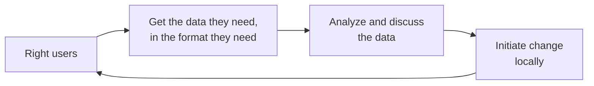

### Naming the Users and Their Decisions { #ncd_routine_data_use_users }

In Diabetes Compass implementations, users are encouraged to consider user perspective of facility managers, district or regional NCD coordinators, and national hospital managers and planners. Each level has its own decisions and cadence, for example:

- **Facility manager, monthly:** order diabetes and hypertension medicines from an essential-medicines forecasting report; review patients active in care, consultations conducted, average wait time, and consultation length in a facility quality-management report.
- **District/regional coordinator, quarterly:** implement WHO "NCD Best Buys" (such as a mass-media physical-activity campaign or facility-based preventive foot care) across district hospitals, and plan supervision based on facility performance.
- **National planner, quarterly:** allocate procurement funding across districts and report to higher levels.

The same structure adapts to local institutions: for example, mechanisms for ordering medications vary by country. The Malawi version orders medicines every six weeks through the Medical Stores Department; the Sri Lanka version orders monthly through the Medical Supply Division.

A second way to find the decisions that matter is to follow the **patient** through the care cascade. The World Bank's [Patient Pathway Analytics](https://openknowledge.worldbank.org/entities/publication/7755ce0b-42f8-4b24-a03c-15f5ba55a291) method maps where people actually seek care and where they drop out. Across care-continuum assessments in five countries, the World Bank extracted 185 barriers and judged 133 of them addressable with digital tools. One of its nine barrier domains is monitoring, program management, and performance oversight, which could be addressed through routine indicator could close.

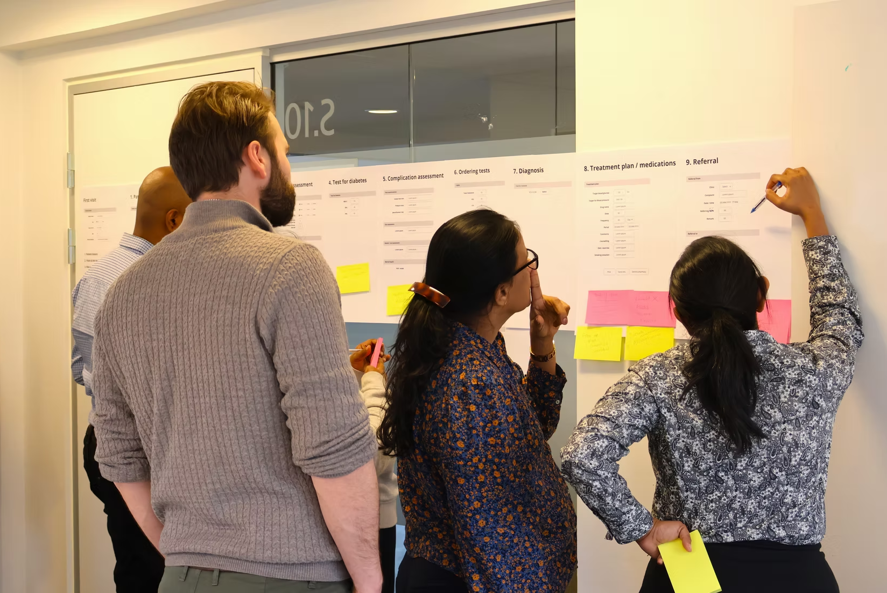

### Distinguishing the Types of Data Use { #ncd_routine_data_use_types }

The Diabetes Compass separates three escalating types of operational facility-level data use:

1. **Facility management**: using aggregate data to run and improve services.
2. **Case management**: using longitudinal individual data to follow patients over time.
3. **Prediction**: using accumulated data to anticipate need.

A fourth type of data use, at the national level, can be considered **public health management** or **policy development**, which is performed less frequently.

Most HMIS work begins with the first. The Diabetes Compass dashboard workshops framed this as a four-phase value chain: *capture, transfer, interpret, use.*

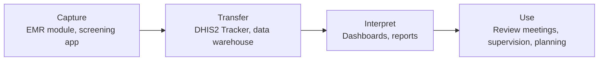

### Building Dashboards Around Decisions { #ncd_routine_data_use_dashboards }

Dashboards should answer the decisions named above, not display every available indicator. Two design rules are essential:

- **Show indicators both ways.** The Sri Lanka dashboard demo presents each indicator as a proportion, for comparison across facilities, and as a raw number, to check the sample is large enough to trust.
- **Use a small set of visualization types.** The [WHO toolkit Module 1](https://www.who.int/publications/i/item/9789240113473) recommends standardized-indicator charts, heat maps, target-achievement charts, performance tables, and trend graphs, with end-user testing before rollout.

> **Example**
>
> In Sri Lanka, [HEARTS360 dashboards](https://www.simple.org/blog/hearts360-dashboard/) are updated daily from DHIS2 and the Simple app, and district health authorities use them to monitor NCD program performance.
>
> In Rwanda, all health centers were trained to report NCD screening through DHIS2, and district teams use screening dashboards with a target of 85% coverage among people over 35; the dashboard graph turns green when a district reaches the target \[NCD webinar, Rwanda presentation; see also [Diagnosing Noncommunicable Diseases with DHIS2 in Rwanda](https://dhis2.org/rwanda-ncd-tracker/)\].

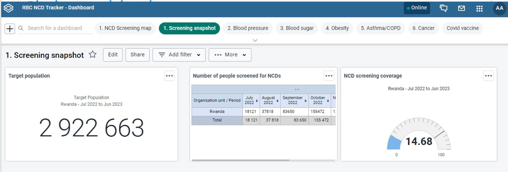

### Minimal Data Entry, Maximal Data Quality { #ncd_routine_data_use_minimal_entry }

In many primary health care facilities, a typical hypertension follow-up visit lasts 2–4 minutes, but dozens of patients can be seen every day. Resolve to Save Lives, which has used both DHIS2 Tracker and the Simple app to monitor its hypertension control projects, sets a performance threshold of under 90 seconds for first-visit data entry and under 20 seconds for follow-up entry \[[RTSL digital tools playbook](https://resolvetosavelives.org/resources/optimal-digital-tool/)\]. Their key finding was that if data entry is *not* fast, health workers will not record BP at every visit, and the control-rate indicator the whole program depends on will be built on incomplete data.

One of the easiest ways to make data entry faster is to accept a minimal dataset needed for program monitoring. The Resolve to Save Lives guidance for digital applications identifies several common data points with limited marginal value for program monitoring. For example, BMI requires weight scales many facilities do not have; individual risk-factor data is time-consuming to collect and rarely changes treatment for a patient already diagnosed; lab results are needed to assess complications at a clinical encounter, but not for the longitudinal record. 

Another way to speed up data entry is to streamline record retrieval by scanning a QR code on the patient's card instead of searching by their name/phone number: this cuts patient search time by as much as 20 seconds per encounter in RTSL's deployments. NCD Tracker systems often need to scale across millions of patients, and **every extra step comes at a significant cost in time, data quality, and patient experience.**

### Planning for the Culture, Not Just the Tool { #ncd_routine_data_use_culture }

The Diabetes Compass capacity-building approach suggests using a Plan-Do-Study-Act (PDSA) cycle: root-cause analysis with a fishbone diagram, a pilot change, a check of its effect, then scale-up. This process identifies local leadership and the mindset of improvement as what drives change across the program. Those small wins for organizational culture can be helped along by focusing on a few simple variables, such as performance on routine complication assessments, rather than a full dashboard.

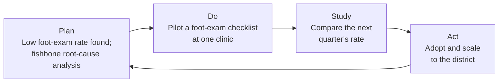

> **Tip**
>
> One shared lesson across the four countries in the DHIS2 NCD webinar was the quickest early win for data use was not a new indicator, but a recurring review meeting where existing data are read and acted on. For example, Rwanda locks its NCD dataset on the 10th of each month to new changes, but only after every facility has reviewed and discussed its collated data.

## Aligning Indicators and Goals { #ncd_routine_data_use_indicators }

A vision needs a defined indicator set, mapped to real data sources, with targets the country owns.

### Mapping the Existing Data Sources { #ncd_routine_data_use_sources }

NCD indicators draw on more than the monthly facility report. The recurring source list across the Diabetes Compass mappings, the WHO toolkit, and the Africa CDC guidance is the same:

- **Monthly facility reports (routine HMIS / DHIS2)**: service-delivery counts such as screenings, registrations, treatment, control, and complications.
- **[STEPS surveys](https://www.who.int/teams/noncommunicable-diseases/surveillance/systems-tools/steps)**: population prevalence of risk factors such as raised blood pressure and raised blood glucose.
- **Health facility assessments ([HHFA](https://www.who.int/data/data-collection-tools/harmonized-health-facility-assessment) / SARA)**: medicine and equipment availability, validated against routine reporting.
- **Logistics systems (LMIS)**: stock counts for medicine-availability indicators. See the DHIS2 [LMIS guidance](https://docs.dhis2.org/en/implement/logistics/overview.html)
- **Registries**: cancer and disease registries for incidence and outcomes (see the [DHIS2 cancer registry toolkit](https://docs.dhis2.org/en/implement/health/non-communicable-diseases/cancer-registry/overview.html)).
- **Vital registration / CRVS**: mortality of NCD patients.
- **Census**: denominators for prevalence and coverage indicators.

How does this mapping look in practice? In Malawi, medicine availability comes from LMIS and facility surveys over a DHIS2 facility count; risk-factor prevalence from STEPS surveys; community detection from the community health information system plus a patient "master card" or EMR; mortality from the vital registration system; and prevalence denominators from DHIS2- or Census-based target population projection.

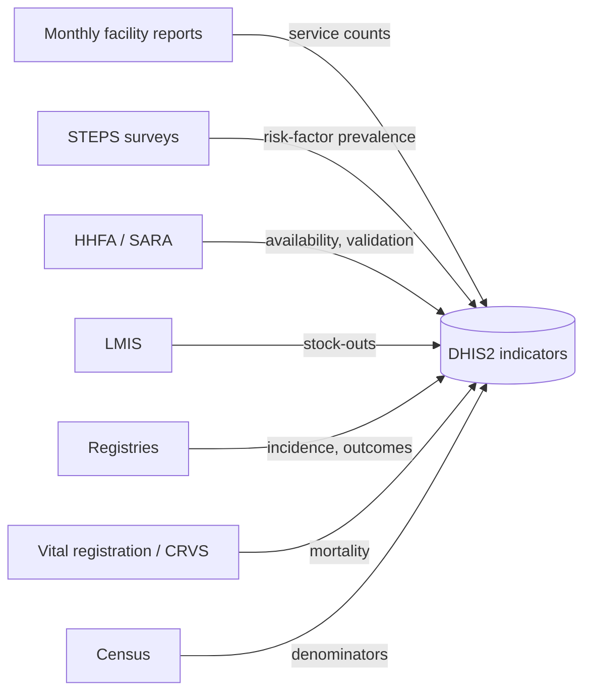

### The Indicator Development Process { #ncd_routine_data_use_indicator_process }

The Diabetes Compass indicator-development process adapts a generic global list to the country context in five steps:

| Step | Actions | Activity |
| :--- | :--- | :--- |
| 1. Prepare | Appoint stakeholders for selection and validation; agree disease areas and selection criteria | Preparatory meetings |
| 2. Select | Review the global NCD indicator list and agree a country-relevant subset | In-country workshop |
| 3. Validate | Produce the framework with full metadata; professional societies and disease programs review and sign off | Online metadata work; expert review meetings |
| 4. Develop | Map indicators to data sources; configure indicators, reports, and analytics in DHIS2 | Configuration and testing |
| 5. Implement | Train health workers on reporting and managers on data use | Training sessions |

The Diabetes Compass global list holds about 180 indicators across NCDs like diabetes, CVD/hypertension, cancer, chronic respiratory disease, and sickle cell, built on the WHO 2022 facility-based monitoring guidance and the PAHO/WHO 2015 NCD compendium. Indicators are selected against a six-point quality check: *valid, well-defined, related to a desired outcome, professionally accepted, communicable, and drawing on data already in the system* without double registration.

> **Example**
>
> In Ethiopia, an indicator is added to the national set only when it is standardized across all facilities and partners, simply defined, integrated into the system, and supported by the tools to capture it from patient cards into registers. Otherwise it is not adopted, regardless of how many partners request it \[See: NCD webinar, Ethiopia presentation\].

### Documenting Indicators with a Consistent Template { #ncd_routine_data_use_indicator_template }

Each indicator is documented with a fixed set of fields: abbreviated name, code, full name, purpose, definition, numerator, denominator, method of calculation, aggregation, disaggregation, data sources, key data elements, reporting frequency, data users, limitations, and any context-specific modification. The calculation convention throughout is numerator divided by denominator times 100.

For each indicator, **identify where the numerator and the denominator come from, because they often come from different systems.** The Diabetes Compass data-mapping process makes this an explicit step and warns that the indicator framework itself "cannot be used as a requirement specification document for programming". A separate country-specific data-source mapping is needed for the people configuring DHIS2.

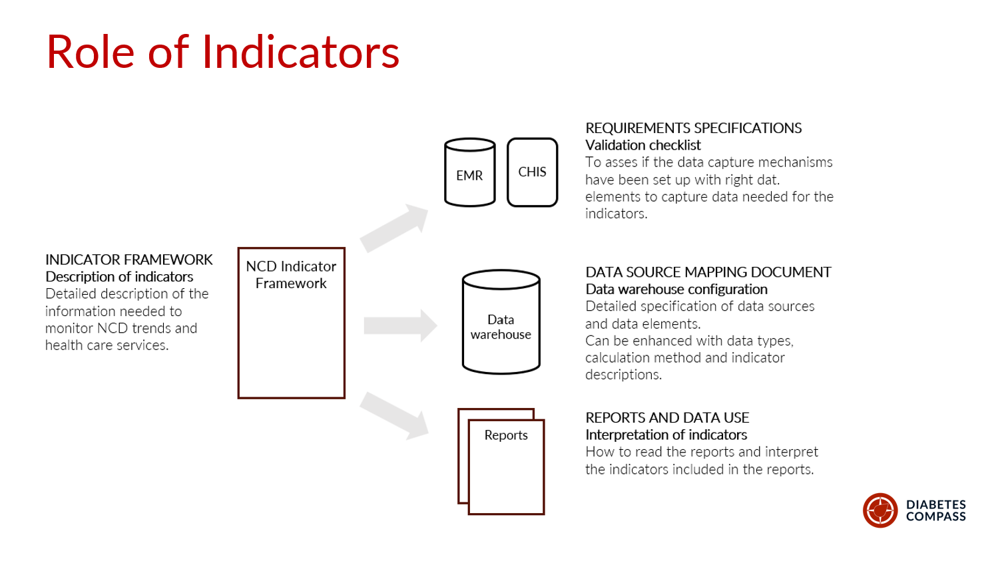{ .center width=80% }

> **Note**
>
> When data-mapping in groups, be candid about gaps. The Malawi mapping flagged indicators where no source exists yet, such as counts of outpatient and inpatient visits at PHC level, which is more useful than pretending coverage is complete.

> **Caution**
>
> Once a set of indicators is agreed and documented, avoid changing an indicator's name, definition, numerator, denominator, or calculation method, because that breaks comparability over time and between countries and leads to confusion.

### Ten Core Indicators to Start With { #ncd_routine_data_use_core_indicators }

A country striving to improve NCD data does not need all 81 WHO indicators to begin. The table below is a starting set of ten, concentrated on the two highest-burden, most-implemented conditions, hypertension and diabetes, plus the cross-cutting indicators that every program needs. It is drawn from the [WHO 2022 core indicator set](https://www.who.int/publications/i/item/9789240057067), which the Diabetes Compass country frameworks, PAHO HEARTS, and SEARO SEAHEARTS programs all reuse.

Calculation throughout is numerator ÷ denominator × 100 unless noted, and the control thresholds are those that recur across the WHO 2022 guidance, Diabetes Compass country handbooks, PAHO HEARTS, and SEARO SEAHEARTS.

| # | Indicator | Numerator / definition | Denominator | Notes and threshold |
| :--- | :--- | :--- | :--- | :--- |
| 1 | People screened for raised blood pressure | People screened for elevated BP in the period | Target adult population (e.g. ≥18, or country age band) | Cross-cutting early detection |
| 2 | People screened for raised blood glucose | People screened for elevated blood glucose in the period | Target adult population | In Diabetes Compass countries, often combined with Ind. #1 for one combined screening contact |
| 3 | Hypertension treatment coverage | People with hypertension on pharmacological treatment | People with hypertension registered / estimated | Estimated denominator from STEPS prevalence × population |
| 4 | Blood pressure control | People with hypertension whose BP is controlled | People with hypertension under care (exclude LTFU, <3 months enrolled) | Controlled = <140/90; <130 systolic for high-risk / diabetes / CKD |
| 5 | Diabetes treatment coverage | People with diabetes on pharmacological treatment | People with diabetes registered (or estimated) | Oral and/or injectable, per protocol |
| 6 | Glycemic control | People with diabetes whose glucose is controlled | People with diabetes under care (seen last 12 months) | Controlled = HbA1c <8% (64 mmol/mol) or FPG <7.0 mmol/L; may consider higher threshold for high risk patients |
| 7 | CKD risk / complication assessment | People with diabetes assessed for complications (foot, eye, kidney) in 12 months | People with diabetes under care (seen last 12 months) | Diabetic foot exam, retinopathy, CKD assessment |
| 8 | Loss to follow-up | People with no visit in the defined window | People registered and under care | Window commonly 6–12 months; SEAHEARTS uses one year |
| 9 | Availability of essential NCD medicines | Facilities with no stock-out of core DM/HTN medicines in the period | All reporting facilities | "Stock-out" defined per country (e.g. >5 consecutive days); source is LMIS, or health facility assessment |
| 10 | Reporting completeness and timeliness | Facilities submitting a complete, on-time NCD report | All facilities expected to report | Cross-cutting data-quality indicator |

This set spans the results chain: screening (1–2), treatment (3, 5), control outcomes (4, 6), complications (7), retention (8), system inputs (9), and data quality (10). A dashboard built on it shows where a program is losing patients along the cascade. A country can add cancer (cervical/breast screening), chronic respiratory disease, or mental health indicators in later phases, as both Tanzania and Malawi did.

> **Note**
>
> The denominators for indicators 3 and 5 can be either the count registered at facilities or an estimate from STEPS prevalence times the catchment population. Registered counts measure the program; estimated counts measure population coverage. Show both where possible, and state which is used, because they answer different questions.

When put together, a country has identified priority indicators and their sources. This diagram from Sri Lanka shows the range from inputs to patient outcomes:

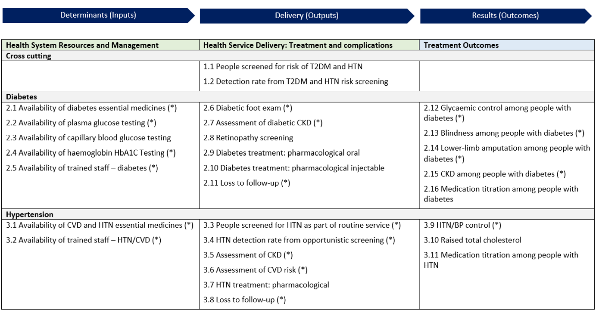{ .center width=80% }

### Setting Targets the Country Owns { #ncd_routine_data_use_targets }

The WHO 2022 guidance defines the indicators but deliberately does not set targets. It states that countries must set their own baselines and targets with stakeholders at each reporting level.

Use survey and regional data to set realistic baselines rather than aspirational round numbers. STEPS surveys give a population baseline; 18 countries in the WHO African Region conducted WHO STEPS surveys between 2020 and 2024, [according to a WHO AFRO report](https://www.afro.who.int/sites/default/files/2025-04/NCD%20Quaterly%20Bulletin%20Final.pdf). Regional benchmarks show how far current performance sits from control.

> **Example**
>
> Hypertension treatment coverage is as low as 11–16% in Kenya, Ethiopia, and Tanzania, and control rates are below 20% in most countries and under 10% in CAR, Ethiopia, Kenya, Niger, and Rwanda \[see: WHO-AFRO NCD Bulletin, Issue 4\]. A target should be reachable from the current baseline within the reporting period, which is why it is a country decision rather than a WHO default.

## Using the Routine Data { #ncd_routine_data_use_using }

Once indicators are defined and reporting, the following work is interpretation. Routine HMIS data have predictable limitations, and reading them without accounting for those limitations can lead to wrong conclusions.

### A Guide for Interpreting HMIS Data { #ncd_routine_data_use_interpreting }

All Diabetes Compass countries identified several rules of thumb for interpreting HMIS NCD data:

- **Both facility-based prevalence data and survey prevalence estimates have their own limitations.** Facility-based data are limited by data capture rates, reporting rates, care-seeking behavior, and access to care. Surveys can reach and estimate undiagnosed cases, but will generally overestimate the number of individuals with a disease as they rely on a single screening test, while formal diagnosis relies on confirmatory diagnostic tests. A routine "diabetes prevalence" indicator should thus be interpreted alongside the survey data. One is not a full replacement for the other.
- **Denominators drift.** Census-based population estimates lose accuracy over time and for small areas, so coverage rates above 100% are possible when the target-population estimate is too low.
- **Count indicators move for many reasons.** A change in newly registered diabetes clients can come from more screening, better diagnostic ability, or improved drug availability, not only from a change in disease.
- **Reporting completeness varies by report.** An indicator's denominator is only as complete as the form it sits on. For example, in Malawi the composite HMIS-15 report runs at roughly 95% completeness, while program-specific reports vary widely.
- **Eligibility rules change the denominator.** Patients lost to follow-up, enrolled under three months, or seen only once are commonly excluded from control-rate denominators. In Malawi, 18 of 28 districts border Mozambique, Zambia, or Tanzania, and patients from neighboring countries may receive care locally, a second route by which coverage rates can exceed 100%.

### Worked Examples from the WHO Toolkit { #ncd_routine_data_use_worked_examples }

[WHO toolkit Module 2](https://www.who.int/publications/i/item/9789240113497) walks through these rules with a synthetic dataset of 10 facilities in two districts. For comparing aggregate data, these examples are worth examining in detail:

**Calculating control at one facility.** The facility "Carbon" has 6 people registered for hypertension care. None are lost to follow-up, but one enrolled in the last three months of the year, so the denominator drops to 5 \[see: WHO toolkit Module 2, Fig. 6, p. 16\].

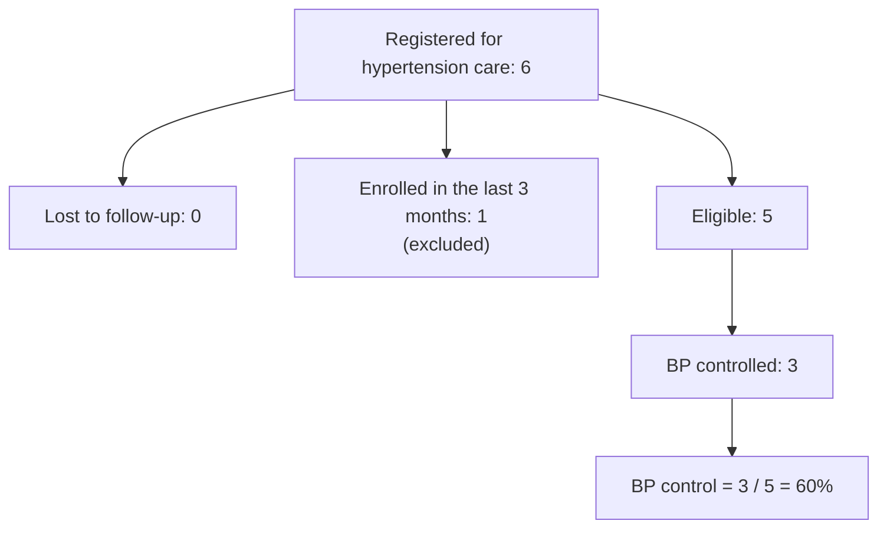

**Comparing facilities.** Repeating the calculation for two more facilities gives a spread on control rates that the facility totals alone would hide \[WHO toolkit Module 2, Table 5 and Fig. 7, p. 17\]:

| Facility | Controlled | Eligible | BP control |
| :--- | ---: | ---: | ---: |
| Carbon | 3 | 5 | 60.0% |
| Oxygen | 2 | 4 | 50.0% |
| Neon | 3 | 8 | 37.5% |
| Average | | | 49.2% |

Carbon and Neon each have 3 controlled patients, but Neon's rate is far lower because it has more eligible patients. This is the reason for showing both the proportion and the raw number on dashboards, as the [DHIS2 hypertension control package](https://docs.dhis2.org/en/implement/health/non-communicable-diseases/hypertension-control/overview.html) does. With denominators of 4 to 8, a single patient moves the rate by 12–25 percentage points, so a review should not rank facilities on rates this small without looking at the counts.

### Reading Order for a Performance Review { #ncd_routine_data_use_reading_order }

WHO toolkit Module 1 recommends an order for reviewing NCD indicators at district or facility level. Start with the outcome indicators (BP control, glycemic control). If they meet the target, the review can stop there. If not, move to the output indicators (screening, treatment, complication assessment, referral) to find the bottleneck, and if the outputs do not explain it, move to the determinants: medicine and diagnostic availability, approved guidelines, and trained staff. In a district meeting, a facility with low BP control and normal treatment coverage points to a clinical or follow-up problem. A facility with low treatment coverage and repeated antihypertensive stock-outs points to supply.

This sequence follows the analytical model in WHO toolkit Module 1, Fig. 3.

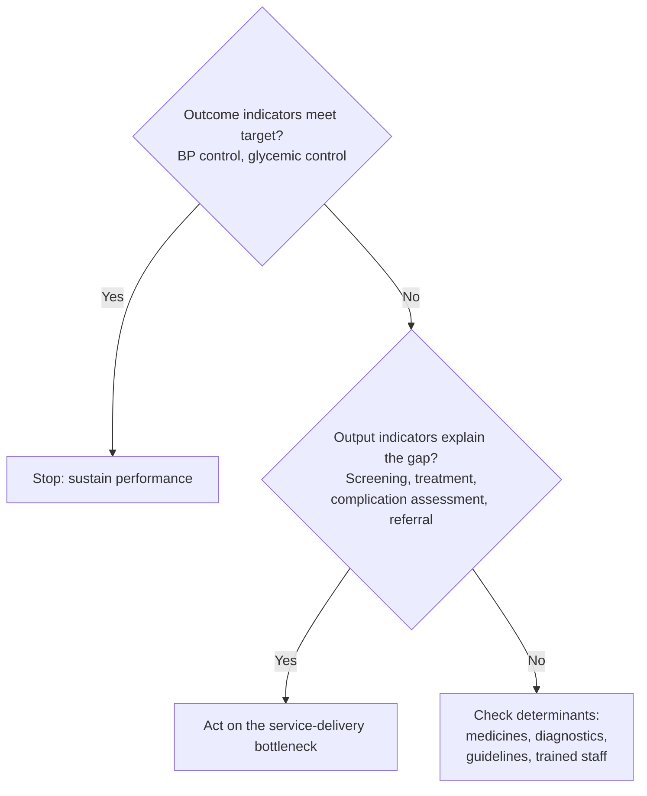

### Checking Data Quality { #ncd_routine_data_use_data_quality }

Interpretation is only as good as the data behind it. Before reading an indicator for what it says about services, check whether the underlying data are trustworthy. WHO toolkit Module 1 sets out four data-quality dimensions with NCD-specific checks:

1. **Completeness and timeliness.** What share of facilities reported, and on time? An indicator computed from half the facilities describes those facilities, not the district. Reporting completeness varies by form, so check it per report rather than assuming one rate (see the Malawi HMIS-15 example above).
2. **Internal consistency.** Flag person-level values 2–3 standard deviations from the mean, check consistency over time, and check that related indicators agree. People treated for hypertension must be at least as many as people with controlled hypertension, because control is a subset of treatment.
3. **External consistency.** Cross-check routine counts against an independent source: medicine quantities in the logistics system, cases in a disease registry, claims in an insurance system, or dispensing data from a pharmacy.
4. **Consistency of population data.** Check the denominator. For cervical cancer screening, compare registered women against the estimated women in the target age group; the ratio is only usable when public and private coverage and age-sex standardization conditions hold.

The Diabetes Compass Tanzania workshop framed the same idea for facility teams as four properties (correctness, completeness, consistency, and timeliness), showing how structured data entry with validation at the point of capture in the GoT-HoMIS EMR micromodule reduced errors before the data reached the HMIS.

DHIS2 validation rules can also encode several of these checks automatically: a control-rate numerator cannot exceed its treatment denominator, screening results by category must sum to the screening total, and implausible monthly jumps can be flagged for review.

> **Example**
>
> In Ethiopia, the data-entry form highlights a data-quality problem in red at the point of entry. For example, when individual screening counts by age do not equal screening counts by result, the discrepancy is flagged immediately rather than discovered later in analysis \[NCD webinar, Ethiopia presentation\].

Digitized patient registries at clinical level can improve data quality, but EMR coverage varies across regions. In Asia, a [2023  capacity survey](https://www.who.int/publications/i/item/9789290220909) in WHO SEARO region found only Thailand runs a fully electronic patient information system at both primary and secondary levels, and only India and DPR Korea report interoperable systems. A similar [2023 EMRO survey](https://www.who.int/publications/b/81553) found 68% of countries in the region with an electronic NCD patient system, and same level for cause-based mortality data. Where systems are partly paper-based, the transcription steps from register to tally sheet to DHIS2 are where errors enter.

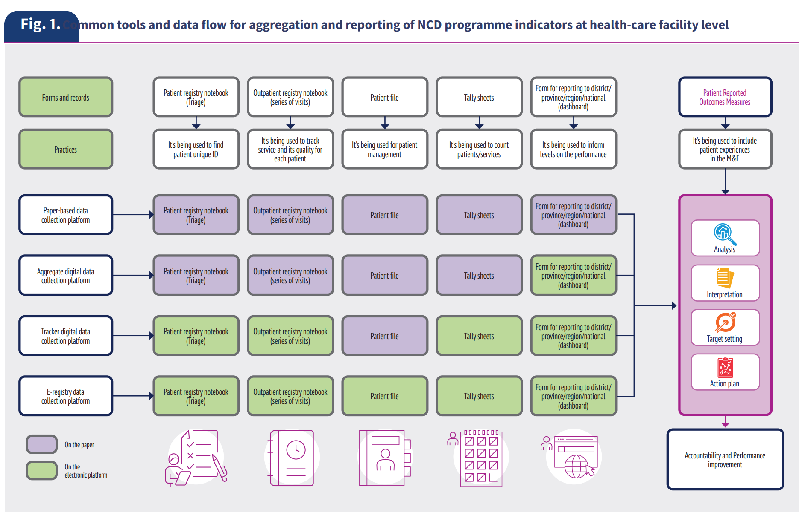{ .center width=80% } -->

### Linking to Alternate Population Sources in DHIS2 { #ncd_routine_data_use_population }

Most HMIS reports, including for NCDs, do not report population denominators every month; these must be drawn from elsewhere in DHIS2. For example, use the latest census for age-bounded population, the latest STEPS survey for estimated diabetes and hypertension prevalence, and the empaneled or target population for coverage indicators. If surveys or census data are many years outdated, consider monitoring program reach through alternate population data sources, like remote-sensed geospatial data from [WorldPop](https://www.worldpop.org/).

In Malawi, HISP identified prevalence of diagnoses on a patient "master card" EMR as "a proxy for the survey-based indicators for NCD prevalence that are more difficult to get on a routine basis". By interpreting these as estimated prevalence rates, they could be combined with population boundaries for estimated prevalence. Inputting these estimates into a DHIS2 population dataset lets coverage and estimated-burden indicators calculate against a useful target population denominator, rather than a facility registration count alone.

### Using Data During Facility Supervision Visits { #ncd_routine_data_use_supervision }

The supervision visit is one of the few recurring moments when a district officer and facility staff look at the facility's data together, so it is a natural point to combine data-quality checking with data use. Two activities fit the visit:

- **Verify the data at source.** Compare a sample of the facility's reported figures against the registers and patient cards behind them. In the NCD webinar, HISP Ethiopia described supportive supervision as the mechanism for catching registration and transcription errors that the system flags but cannot fix on its own. This is the external/source check from the data-quality dimensions, done in person.
- **Use the data to plan with the facility.** Bring the facility's own dashboard or quality report to the visit and work through it with staff: which indicators are below target, which patients on the line list need follow-up, and what the facility will change before the next visit. Diabetes Compass guidance suggests countries use a quarterly facility quality-management report and two patient line lists (most vulnerable, and nearly controlled) to give a supervisor a concrete agenda rather than a generic checklist.

Supervision can be digitized so its findings become data in their own right. The WHO 2022 NCD guidance includes a cross-cutting indicator on the proportion of facilities receiving a supervisory visit, which turns supervision coverage into something a district can monitor. For example, eRDQA (Routine Data Quality Assessment) and DQR-RSC (Data Quality Review Routine Supervision Checklist) are supervision tools implemented in the [DHIS2 Supervision app](https://docs.dhis2.org/en/implement/data-quality/supervision-web.html). These short structured supervision checklists let a district document and aggregate supervision results the same way it aggregates service data, and see which facilities have not been visited.

> **Tip**
>
> Pair every supervision visit with a data-quality check and a data-use discussion, and record the visit itself. A facility that knows its data will be read at the next visit has a reason to keep the registers current between visits.

Finally, countries should integrate automated metrics such as reporting completeness, timeliness, and internal consistency from the [WHO Data Quality Assurance (DQA) toolkit](https://www.who.int/data/data-collection-tools/health-service-data/data-quality-assurance-dqa) directly into DHIS2 review workflows. Routinely applying these standard DQA tools during monthly desk reviews helps detect discrepancies, correct entry errors at the source, and ensure reliable data for decision-making. The [DHIS2 Data Quality Workbench](https://dhis2.org/webinars/implementation-insights-dq-workbench/) is one collection of tools to support DQ analysis at a high level.

## Expanding into the Wider Health Information System { #ncd_routine_data_use_his }

Aggregate HMIS reporting is the starting layer, not the whole system.

The WHO toolkit describes a four-level platform maturity model:

1. **Level 1**: paper-based.
2. **Level 2**: digital aggregate (DHIS2 aggregate).
3. **Level 3**: digital patient and program monitoring (Tracker).
4. **Level 4**: full e-registry or EMR.

Most NCD programs are moving from Level 2 toward Levels 3 and 4, which means connecting other data sources to the routine system. DHIS2 is the routine reporting layer within a wider routine health information system (RHIS), and the other sources feed it. At Level 4, multiple EMRs could feed into a national standardized NCD register (for example, in DHIS2 Tracker) in order to calculate routine reports. 

WHO toolkit Module 1, Fig. 12, sets out a roadmap for moving between these levels at national and subnational level.

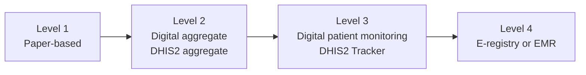

### Setting Realistic Expectations for Interoperability { #ncd_routine_data_use_interoperability }

In HISP's Tracker implementations, we have often found it extremely difficult to design for "full interoperability between systems" without an established base of high-quality routine data and strong governance for sharing patient-level data. In its own experience with digitalized NCD registries, [Resolve to Save Lives has found](https://resolvetosavelives.org/resources/optimal-digital-tool/) interoperability is "rarely achieved in full", and thus recommends a pragmatic approach: the first priority for NCD programs is to ensure digital registries store data in a standardized, documented format so it can feed a national DHIS2 dashboard.

Of course, many contexts are already at Level 3 or Level 4 for their NCD platforms, and plan for a broader digital architecture. [Sri Lanka's Diabetes Compass implementation](https://dhis2.org/fighting-ncds-in-malawi-and-sri-lanka-with-the-diabetes-compass-project/) connects multiple digital tools across community, hospital, and clinic settings using shared standards. Guided by the national digital health blueprint, the Sri Lanka Ministry of Health selected OpenSRP, a FHIR-native app, to manage patient interactions across household screening, hospital Healthy Lifestyle Centers, and follow-up medical clinics. Data captured with the OpenSRP Android FHIR SDK is sent to a central FHIR repository that connects to other EMRs and systems, including DHIS2 for downstream aggregate monitoring and dashboards.

### Mapping EMR and Community Data to Indicators { #ncd_routine_data_use_mapping }

The Diabetes Compass data-mapping work shows two directions of the same job. Malawi maps from each indicator down to its source variables. Tanzania maps from EMR variables up to indicators, working from the structure of the GoT-HoMIS diabetes/hypertension micromodule and using ICD-10 codes to route diagnoses: E11 to the type 2 diabetes detection rate, I10/I15 to hypertension, N18 to chronic kidney disease, and so on. Sierra Leone adds a FHIR logical model as an abstraction layer so the mapping is portable across countries and EMRs.

The shared pattern across all three countries is EMR module → FHIR server → DHIS2 indicators, with a community risk-screening tool feeding in alongside: OpenSRP in Sierra Leone and Tanzania, iCHIS in Malawi.

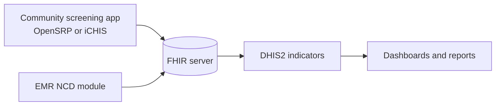

### How Countries Have Connected Other Sources { #ncd_routine_data_use_country_examples }

HISPs findings shgow that in 2026, countries are at different stages of extending NCD data systems beyond HMIS reporting.

| Country | Routine layer | Other sources connected (or planned) |
| :--- | :--- | :--- |
| Rwanda | Aggregate NCD and cancer-screening datasets in DHIS2 | Cancer registry, [NCD screening tracker](https://dhis2.org/rwanda-ncd-tracker/), and OpenMRS EMR run as separate systems, not yet integrated |
| Ghana | NCD data in DHIMS2 via monthly OPD morbidity returns and a new NCD dataset | Plans to integrate line-listed Lightwave EHR data and deploy a comprehensive NCD tracker package to clinics without EHRs |
| Malawi | NCD dataset and PEN-Plus monthly form in DHIS2 | Paper NCD register, PIH "YendaNafe" EMR, NCD master card, and [iCHIS community module](https://dhis2.org/fighting-ncds-in-malawi-and-sri-lanka-with-the-diabetes-compass-project/); EMR interoperability under development |
| Nigeria | HEARTS360 aggregate dashboards | Individual hypertension and diabetes patients managed in a [DHIS2 Android Tracker app](https://community.dhis2.org/t/making-software-health-workers-love-to-use-got-us-the-data-we-need-nigeria-hypertension-case-study/57676) for the NHCI in Kano, Ogun, and FCT Abuja |
| Zimbabwe | Routine HMIS | Hypertension and diabetes screening nested inside the HIV program, captured in a customized DHIS2 Tracker Capture app |
| Tanzania (new row) | DHIS2 national HMIS | GoT-HoMIS national EMR with an NCD module available in 6,000 PHC facilities; integrates with DHIS2; data exchange planned through the Tanzania Health Enterprise Architecture |

### Policy and Governance Levers { #ncd_routine_data_use_policy }

The [Africa CDC guidance](https://africacdc.org/download/guidance-for-strengthening-non-communicable-diseases-injuries-and-mental-health-surveillance-systems/) recommends setting the same direction at policy level: develop a roadmap to include NCD(I) and mental health indicators in DHIS2, build eTracker modules, and adopt unique patient identifiers.

Leadership to advance stronger routine NCD data is critical; in an Africa CDC reivew of NCD surveillance 10 African Union member states, the lowest assessed level of maturity was both strategic direction and data quality.

In Ghana, a regulatory policy requires private providers to submit data directly into DHIS2, with license non-renewal for non-compliance. This addresses the inconsistent private and rural reporting, which has previously been identified by HISP Ghana as a key gap.

A **unique patient identifier** is the cornerstone to several of these gains. In Malawi, matching screened people to diagnosed people through a unique ID reduced both over- and under-estimation in detection-rate indicators. But building such a connected web of patient-level NCD data brings **privacy obligations** with it.

The [World Bank primer](https://openknowledge.worldbank.org/entities/publication/7755ce0b-42f8-4b24-a03c-15f5ba55a291) lists the data privacy govnernance decisions a ministry needs to make:

 - a consent model (opt-in, opt-out, or dynamic) that fits the legal framework and local norms;
 - consent forms that state what is collected, why, who can see it, and how to withdraw;
 - training for health workers and patients on patient rights and consent;
 - data governance policies, including minimum-necessary disclosure and, for mental health,
   labelling sensitive data for extra protection;
 - role-based access, encryption, and audit trails in every system that holds patient records.

In DHIS2, role-based access and audit trails are configured through user roles, sharing settings, and program ownership; see the DHIS2 documentation on Tracker security.

> **Tip**
>
> When connecting an EMR or community tool to DHIS2 Tracker, send program indicators from the individual-level system to an aggregate dataset for analysis, rather than building dashboards directly on case data. This keeps the routine reporting layer stable while the individual-data layer matures, and matches the pipeline the Diabetes Compass countries built (EMR → FHIR → DHIS2 indicators). See the [DHIS2 Integration Toolkit](https://dhis2.org/integration/integration-toolkit/) for patterns and tools.

## Where to Start { #ncd_routine_data_use_where_to_start }

A country already reporting some NCD data in DHIS2 can sequence this work so that each step produces something usable on its own:

1. Confirm the decisions the data should support and the people who make them ([Setting a Vision for Actionable Data](#ncd_routine_data_use_vision)).
2. Map the data sources behind a small set of priority indicators, define those indicators with the template and five-step process, and set baselines from STEPS or existing surveys before setting targets ([Aligning Indicators and Goals](#ncd_routine_data_use_indicators)).
3. Build one or two dashboards tied to a recurring review meeting, and equip the people in that meeting to read the data with its biases in mind ([Using the Routine Data](#ncd_routine_data_use_using)).
4. Connect the next data source, usually a community screening tool or an EMR, to the routine system, using a documented mapping ([Expanding into the Wider Health Information System](#ncd_routine_data_use_his)).

The aim is to accumulate data that are used for public health decisions, not to build a complete system before any data gets used.

## Further Resources { #ncd_routine_data_use_resources }

- [DHIS2 for Noncommunicable Diseases](https://dhis2.org/ncd/): overview, case studies, and webinar recordings.
- [DHIS2 Health Data Toolkit](https://dhis2.org/health-data-toolkit/) and [metadata downloads](https://dhis2.org/metadata-downloads/): reference metadata packages for hypertension control, cancer registry, and eye and ear care.
- [HISP Centre and World Diabetes Foundation partnership](https://dhis2.org/hisp-centre-world-diabetes-foundation-partnership/) (2025): planned expansion of the DHIS2 NCD toolkit for diabetes, hypertension, asthma, and chronic respiratory disease.
- [Strengthening Routine National Data on Diabetes Risk and Care](https://www.worlddiabetesfoundation.org/what-we-do/projects/wdf25-1956): World Diabetes Foundation project page.
- [Using DHIS2 to support cardiovascular health in the Americas](https://dhis2.org/hearts-support-cardiovascular-health-americas/): the PAHO HEARTS DHIS2 platform.
- [HEARTS360 dashboard](https://www.simple.org/blog/hearts360-dashboard/): open-source dashboard for WHO HEARTS indicators, available in DHIS2.
- [DHIS2 Community of Practice](https://community.dhis2.org/): ask questions and share NCD implementation experience.

## References { #ncd_routine_data_use_references }

- World Health Organization (2022). [*Noncommunicable disease facility-based monitoring guidance: framework, indicators and application.*](https://www.who.int/publications/i/item/9789240057067) Geneva: WHO.
- World Health Organization (2025). *Toolkit for the analysis and use of facility-based data on non-communicable diseases.* [Module 1: Surveillance tools and methodologies in primary care settings](https://www.who.int/publications/i/item/9789240113473); [Module 2: Companion training exercises](https://www.who.int/publications/i/item/9789240113497); [Module 4: E-registry user manual](https://www.who.int/publications/i/item/9789240117525). Module 3 (DHIS2 user manual) is available from the [WHO NCD surveillance, monitoring and reporting page](https://www.who.int/teams/noncommunicable-diseases/surveillance/systems-tools/patient-programme-monitoring).
- Quiambao, A., Farzadfar, F., et al. (2025). [World Health Organization's guidance for tracking non-communicable diseases towards sustainable development goal 3.4: an initiative for facility-based monitoring](https://doi.org/10.1016/j.eclinm.2025.103304). *eClinicalMedicine* 85: 103304.
- Africa CDC (2023). [*Guidance for Strengthening Non-Communicable Diseases, Injuries and Mental Health Surveillance Systems.*](https://africacdc.org/download/guidance-for-strengthening-non-communicable-diseases-injuries-and-mental-health-surveillance-systems/)
- WHO Regional Office for Africa (2025–2026). *Noncommunicable Disease Bulletin*, Issues 1–4. [Issue 1](https://www.afro.who.int/sites/default/files/2025-04/NCD%20Quaterly%20Bulletin%20Final.pdf); [Issue 3](https://www.afro.who.int/publications/dpc-noncommunicable-diseases-quarterly-bulletin-issue-03).
- Prado, P., Ordunez, P., et al. (2022). [Monitoring and evaluation platform for HEARTS in the Americas](https://doi.org/10.26633/RPSP.2022.161). *Rev Panam Salud Publica* 46: e161.
- World Diabetes Foundation / HISP, *Diabetes Compass* project materials: use-case visions, cultures of data use, indicator development process and template, dashboard specifications, and data-source/FHIR mappings for Sri Lanka, Tanzania, Malawi, and Sierra Leone. See also [Fighting NCDs in Malawi and Sri Lanka with the Diabetes Compass Project](https://dhis2.org/fighting-ncds-in-malawi-and-sri-lanka-with-the-diabetes-compass-project/).
- HISP Centre (2024). [*Noncommunicable Disease Data in National HMIS: Rapid Reviews from Four Countries*](https://dhis2.org/events/webinar-ncd-hmis-data-may-2024/) (Ethiopia, Rwanda, Ghana, Malawi). [Webinar recording](https://youtu.be/DqyJRG10iMA).
- Resolve to Save Lives (2024). [*Designing an Optimal Digital Tool for Hypertension and Other Long-Term Treatment Programs*](https://resolvetosavelives.org/resources/optimal-digital-tool/).
- World Bank (2025). Sichel, A., BenDor, A., Celentano, K., Hulse, M., and Habib, A. [*Digital Transformation for Person-Centered NCD and Mental Health Care: A Primer.*](https://openknowledge.worldbank.org/entities/publication/7755ce0b-42f8-4b24-a03c-15f5ba55a291) Washington, DC: World Bank. CC BY-SA 4.0.
