# NCD Toolkit v1.0: Essentials for Diabetes and Hypertension Monitoring { #ncd-hdm-design }

## Introduction { #ncd-hdm-design-introduction }

### Purpose { #ncd-hdm-design-purpose }

This guide describes the conceptual design of the noncommunicable disease (NCD) Toolkit, a DHIS2 configuration package for routine hypertension (HTN) and diabetes mellitus (DM) monitoring. It covers the aggregate datasets, the HTN/DM Tracker program, the analytics built on both, and the four **NCD_HDM** dashboards. It is intended for DHIS2 implementers and ministry of health technical staff who are adapting the toolkit to a country context. Local workflows and national treatment guidelines should be reviewed against this design before deployment.

The toolkit supports two data collection modes for the same set of core indicators — aggregate reporting through monthly summary forms, and individual patient tracking through DHIS2 Tracker — so that a country can start with the mode its facilities are ready for and move to the other without changing indicator definitions.

### Background { #ncd-hdm-design-background }

The NCD Toolkit draws on three lines of prior work. At its core is the Resolve to Save Lives (RTSL) Hypertension Registry, which was deployed in Nigeria at scale and documented in its own DHIS2 [system design guide](https://github.com/simpledotorg/dhis2-hypertension-package/blob/main/doc/design_guide.md). The NCD toolkit builds on a later release of RTSL's Tracker program, which included diabetes monitoring. The WHO HEARTS technical package and the 2022 [*Noncommunicable disease facility-based monitoring guidance*](https://www.who.int/publications/i/item/9789240057067) advanced the HTN/DM indicator framework and thresholds used throughout (blood pressure (BP) control at <140/90 mmHg, glycaemic control at HbA1c <7% or fasting blood sugar (FBS) <126 mg/dL). The World Diabetes Foundation [Diabetes Compass](https://www.diabetescompass.org/) project contributed country evidence to dashboard design for different health system levels, modular add-ons for DM complications management, and DHIS2 integration patterns.

This is an initial release covering HTN and DM aggregate reporting and Tracker. It is **built to adapt and extend**: the same monthly and tracker structure could support other NCDs, and cross-cutting modules for medicine stock and health facility assessment already exist in the same DHIS2 instance and can be layered onto the same dashboards in a later phase. Within the HTN/DM cascade of care, this initial release can be extended by community NCD screening apps and cause of death reporting.

## System design overview { #ncd-hdm-design-overview }

### Use cases for NCDs { #ncd-hdm-design-use-cases }

The toolkit is built around three recurring decisions, matching the facility, district, and national levels described in the NCD data use guidance this toolkit follows:

A facility manager reviews the monthly HTN and DM summary to see how many registered patients are under care, how many have controlled blood pressure or blood sugar at their latest visit, and how many have not been seen in three or twelve months. This is the decision the monthly dataset and the patient-under-care indicator tree are built to support.

A district or regional coordinator compares facilities on the same indicators, expressed as both a percentage and a count, to target supervision and medicine distribution.

A national planner or policy team reviews change from the previous month on the same core indicators, aggregated to district or national level, to track program-wide performance over time and report to the health management information system (HMIS).

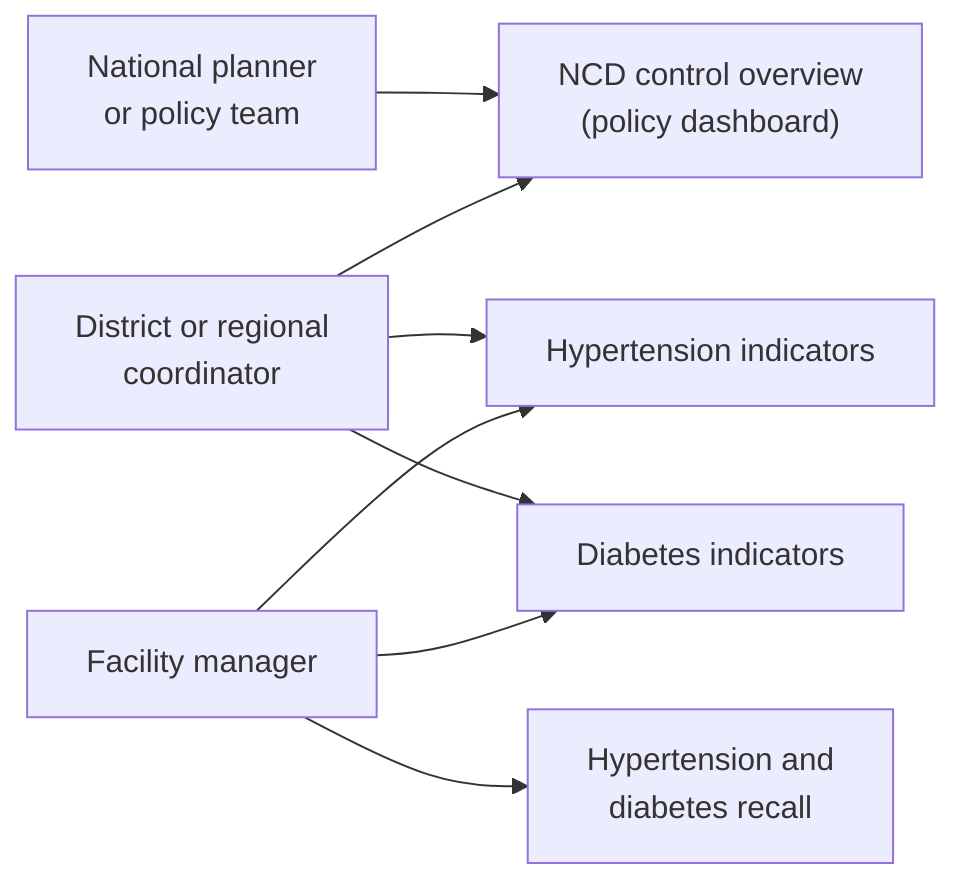

### Three scenarios for NCD data readiness { #ncd-hdm-design-scenarios }

A country adopting the toolkit is usually in one of three starting positions, and the toolkit is designed so each one produces usable data without waiting for the others.

**Aggregate support.** The country already collects some HTN/DM service data through routine HMIS forms, but has no patient-level digital system. The monthly HTN and DM datasets and the quarterly cohort dataset are the entry point: facility staff report aggregate counts, and the core indicators (registrations, patients under care, control rates, loss to follow-up) are available from month one.

**HTN/DM control program.** The country is running, or piloting, a dedicated hypertension or diabetes control program and wants to track individual patients over time — registration, visit history, medication, and control status per patient. This is the Tracker scenario: DHIS2 is the system of record for the control program, used directly by clinical staff.

**EMR already collects NCD data.** The country has an electronic medical record (EMR) or other point-of-care system already capturing HTN/DM encounters, and does not want a second system of data entry at facility level. Here Tracker is not the primary capture tool but a passive receiver: the EMR pushes standardized individual-level data — enrollments and visit-stage events — into this same HTN/DM Tracker program, so DHIS2 still holds the individual patient register the program indicators and dashboards are built on, without adding a parallel clinician-facing data entry workflow.

The second and third scenarios both use Tracker, but for different purposes — one as the active data entry tool for a targeted control program, the other as a passive consumer of data already captured elsewhere. Both feed the same national HMIS datasets, so the district- and national-level analysis does not need to know which scenario produced the data. This distinction should be made explicit to implementers early, because it changes how much of the Tracker configuration (skip logic, mandatory fields, the calling report) is relevant — an EMR feed does not need clinic-facing form logic designed for a data entry clerk.

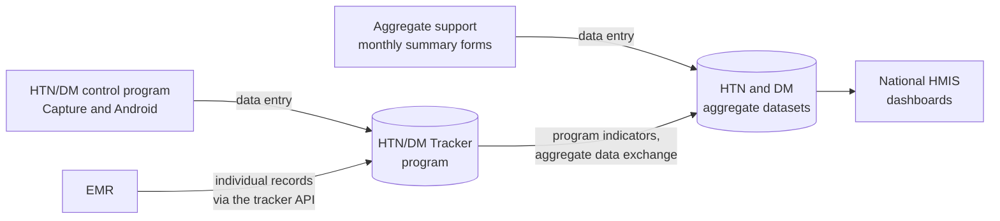

### Contextual implementation { #ncd-hdm-design-contextual-implementation }

Every country implementation should review the following before rollout, since the default package makes assumptions that will not hold everywhere:

- Control thresholds (140/90 mmHg; HbA1c 7% and 9% tier boundaries; FBS 126 and 200 mg/dL tier boundaries) against national clinical guidelines.
- The three- and twelve-month lookback windows used to define "under care" and "lost to follow-up," against the national visit schedule for HTN/DM patients.
- Which of the two medication lists (currently amlodipine, hydrochlorothiazide, losartan, telmisartan for HTN; metformin, glibenclamide, insulin, atorvastatin, aspirin, beta blocker for DM) matches the national essential medicines list.
- Whether the Sex-only disaggregation on HTN indicators and the Sex-and-Age disaggregation on DM indicators (age bands: 0–17 years, 18+ years) match reporting requirements, or need a finer age split.
- Whether the optional calling report stage (for tracking follow-up of overdue patients) is relevant, since it assumes phone-based outreach capacity at facility level.

## Program structure { #ncd-hdm-design-program-structure }

The toolkit combines aggregate datasets and a Tracker program covering the same two conditions, plus two cross-cutting modules: a monthly stock report from the logistics management information system (LMIS) and a Health Facility Profile (HFP) assessment. This guide covers the HTN/DM aggregate and Tracker configuration in detail. HFP and stock are described only as extension points in the [Analytics](#ncd-hdm-design-analytics) and [Dashboards](#ncd-hdm-design-dashboards) sections below.

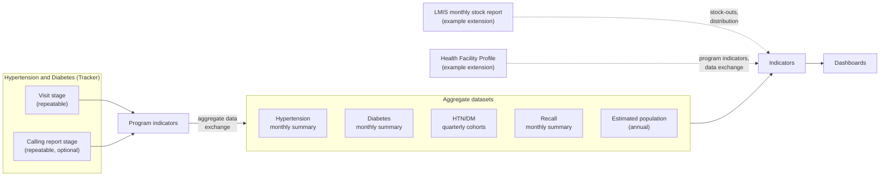

### Aggregate datasets { #ncd-hdm-design-aggregate-datasets }

Four datasets carry HTN/DM service data, all using section-type data entry forms:

**HTN monthly summary** (`Hypertension monthly summary`, monthly, Android-enabled) and **DM monthly summary** (`Diabetes monthly summary`, monthly) each have a Treatment section with the core registration and control indicators, plus condition-specific sections. The DM form adds a Complications management section (chronic kidney disease (CKD) assessment, diabetic foot assessment, visual acuity assessment, and treatment with oral or injectable medication) and an "Optional, autocalculated by Tracker only" section for the finer blood-sugar control tiers.

**HTN/DM recall monthly summary** (`Hypertension and diabetes recall monthly summary`, monthly) holds the calling-report figures for patients with hypertension, diabetes or both: contactable patients overdue at the start of the month, overdue patients called, and called patients who returned to care within 15 days of a call. The last two are disaggregated by result of call. The form also has patients under care with either condition, counting a patient with both conditions once, as the denominator for the overdue rate. Only countries running Tracker and the recall workflow use this dataset (see [Recall of overdue patients](#ncd-hdm-design-recall)). The aggregate data exchange fills it from program indicators.

Data elements on the HTN form use the Sex category combination; DM form data elements use Sex and Age (0–17 / 18+ years). A country reporting through the aggregate-only path (the first data-readiness scenario) enters these directly each month; a country running Tracker has these same totals calculated automatically by program indicators and does not re-enter them.

**HTN/DM quarterly cohorts** reports four indicators per condition once a quarter, using an enrollment-cohort logic distinct from the monthly figures — see [Quarterly cohort vs. monthly calculations](#ncd-hdm-design-quarterly-vs-monthly).

#### Patient categorization tree { #ncd-hdm-design-patient-tree }

The monthly Treatment section indicators are built as a single mutually exclusive breakdown, and this tree is what both the monthly form and the Tracker program indicators are structured around. For hypertension:

```
HTN - Cumulative registrations
  HTN - Patients under care
    HTN - Patients with no visit in past 12 months
    HTN - Patients under care registered before the past 3 months
      HTN - Patients under care with controlled BP at latest visit in past 3 months, registered before the past 3 months
      HTN - Patients under care with uncontrolled BP at latest visit in past 3 months, registered before the past 3 months
      HTN - Patients under care with no visit in past 3 months, registered before the past 3 months
```

This structure follows the Diabetes Compass indicator framework, which uses a similar clustering for control for "patients active in care".

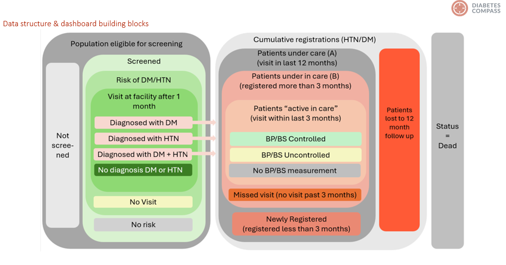

> **Note**
>
> As in HEARTS360, a visit counts only if it has a valid reading. For hypertension that means both systolic and diastolic blood pressure. For diabetes it means an HbA1c, or an FBS in the field that matches the selected unit; random blood sugar (RBS) and post-prandial blood sugar (PPBS) do not count. A patient who visited in the last three months without a valid reading is in the "no visit" category.

The last three lines are mutually exclusive and sum to "Patients under care registered before the past 3 months." A patient registered within the last three months is under care, but is excluded from the controlled/uncontrolled/no-visit split for two reasons: three months gives a newly registered patient time to start and adjust medication before control is measured, and without this exclusion the mostly-uncontrolled newly registered group would pull the reported control rate down in a way that does not reflect the stable caseload's actual performance. Patients recorded as deceased are excluded from every branch of the tree, since a deceased patient is no longer in treatment and, left in, would eventually inflate the loss-to-follow-up count instead.

Diabetes uses the same tree, with the controlled/uncontrolled split expanded into three blood-sugar tiers instead of two: controlled (FBS <126 mg/dL or HbA1c <7%), uncontrolled-lower (FBS 126–199 mg/dL or HbA1c 7–8.9%), and uncontrolled-upper (FBS ≥200 mg/dL or HbA1c ≥9%).

A combined "uncontrolled" figure (FBS ≥126 mg/dL or HbA1c ≥7%) is used as the default for dashboards in this toolkit.

### Data validations { #ncd-hdm-design-data-validations }

The Hypertension monthly summary and Diabetes monthly summary datasets carry 38 validation rules (16 HTN, 22 DM), all scoped to a single month-orgunit report — none compares across periods or org units. They fall into three groups.

**Tree-consistency rules** enforce the patient categorization tree itself: patients under care cannot exceed cumulative registrations, patients under care plus no-visit-in-12-months must equal cumulative registrations, and the controlled/uncontrolled/no-visit-in-3-months leaves must sum to patients under care registered before the past 3 months. The equivalent diabetes rules apply the same logic to the three blood-sugar tiers instead of two.

**Plausibility rules** flag values that are mutually valid but statistically unlikely — monthly registrations spiking far above the cumulative total, uncontrolled-BP counts far exceeding controlled counts, or a no-visit count implausibly large relative to the under-care population. These are soft checks intended to prompt a second look rather than block submission.

**Compulsory-pair rules** catch a specific zero-reporting failure mode: a facility that reports activity on a derived indicator (an overdue-call outcome, a no-visit leaf) while reporting zero on the registration count that activity depends on. DHIS2's `compulsory_pair` operator with `missingValueStrategy: SKIP_IF_ANY_VALUE_MISSING` is used for these, since a true zero on both sides is valid and should not fire the rule.

Every rule references its data elements by UID with a bare `#{dataElementUid}` expression (no category-option-combo suffix), so each expression sums across all disaggregations for that data element — the dataset-total comparison these rules intend, rather than a per-category check. The ruleset is implemented and importable; extending it to a second country's instance only requires re-resolving the data element UIDs, since the rule logic itself does not change.

### HTN/DM Tracker { #ncd-hdm-design-tracker }

The Tracker program is **Hypertension & Diabetes**, a single `WITH_REGISTRATION` program covering both conditions. The two related conditions are often treated together, therefore they are combined into a single Tracker program for ease of use.

#### Structure { #ncd-hdm-design-tracker-structure }

**Attributes.** Registration captures identifying and consent attributes largely shared with other DHIS2 tracker packages (the `GEN -` prefixed Common Metadata Library attributes: name, date of birth, sex, contact details, national ID) plus program-specific attributes: consent to record data, whether the patient has hypertension and/or diabetes, prior treatment history for BP or diabetes medicines, history of heart attack, stroke, or kidney disease, health insurance status, and an overall NCD Patient Status / follow-up status pair used to track active, lost-to-follow-up, transferred, and deceased patients.

**Stages and sections.** The program has two stages:

- **Hypertension & Diabetes visit** (repeatable, one per patient encounter) — the core clinical stage, with three sections: Hypertension record (blood pressure), Diabetes record (blood sugar reading and unit), and Medicines. A patient enrolled for only one of the two conditions will not need both clinical sections completed; see [Skip logic for DM/HTN](#ncd-hdm-design-skip-logic).
- **Calling report** (repeatable, optional) — records outreach to overdue patients: result of call, and whether the patient returned to care within 15 days. This stage exists only for countries running the phone-based follow-up workflow described in [Contextual implementation](#ncd-hdm-design-contextual-implementation), and can be omitted entirely where that workflow is not in use.

| Capture (web) | Android |
|---|---|
| 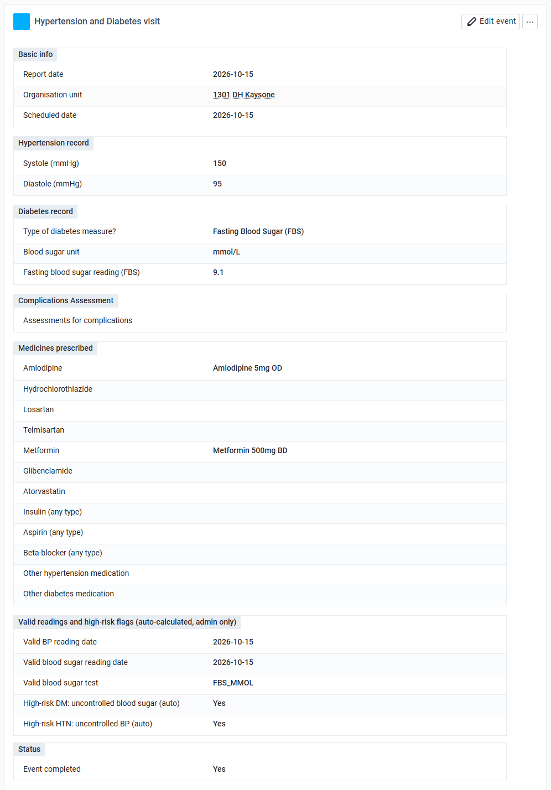 | 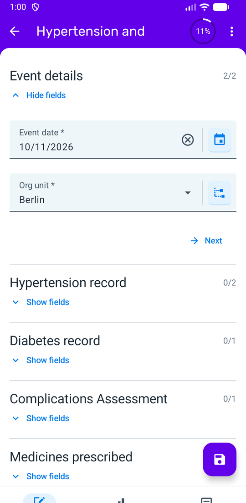 |

The patient dashboard lists the visits. When a visit is completed, the app offers to schedule the next one 28 days later (the stage's standard interval), and the scheduled visit appears on the dashboard. Overdue status and the recall workflow are based on that scheduled visit.

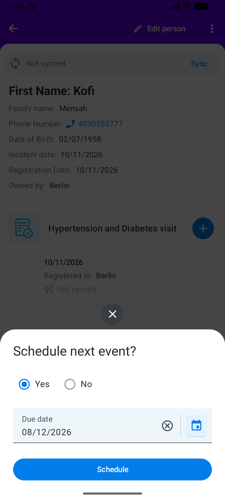{ .center width=40% }

| Capture (web) | Android |
|---|---|
| 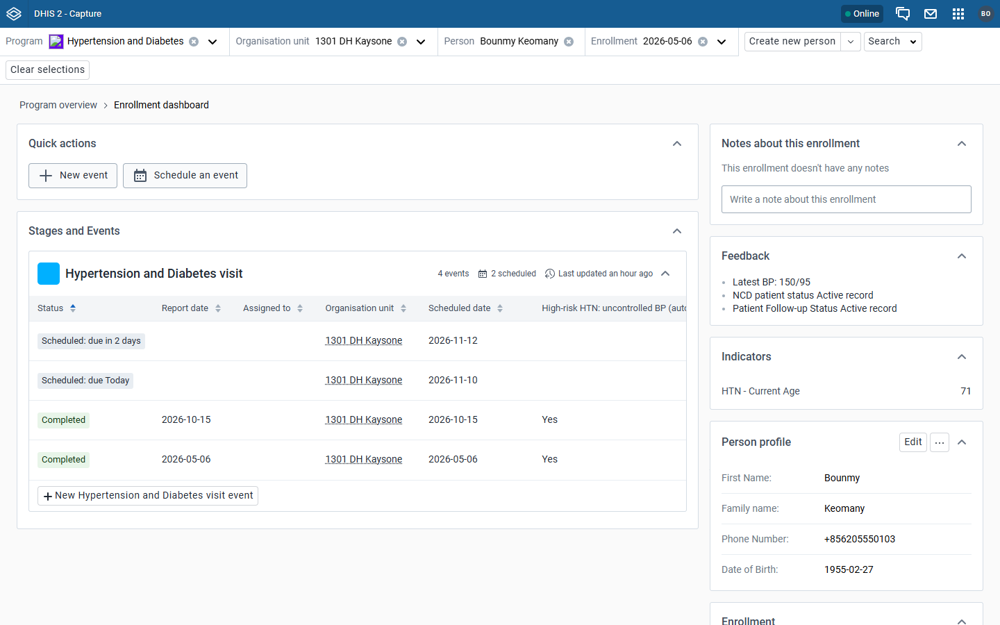 | 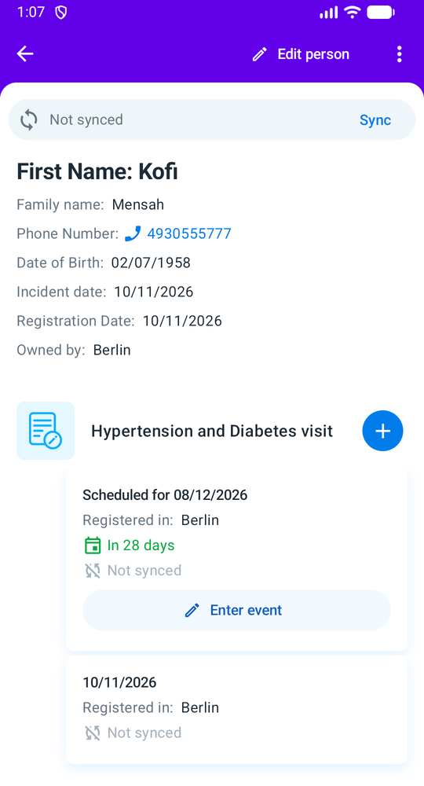 |

#### Skip logic for DM/HTN { #ncd-hdm-design-skip-logic }

Program rules drive four kinds of behavior in the visit stage:

- **Condition-based stage display.** The Diabetes record section is shown only if the patient's blood sugar status indicates diabetes (or the patient was enrolled with a diabetes diagnosis); the Hypertension record section is shown correspondingly for hypertension. A patient enrolled for hypertension only is not asked to complete diabetes-specific fields, and vice versa.
- **Value-dependent field display.** Blood sugar entry fields are hidden until a measurement type (FBS, PPBS, RBS, or HbA1c) and unit are selected, then only the matching numeric field is shown. The medicines list is based on the patient's diagnosis — hypertension medicines for an HTN-only patient, diabetes medicines (including the newly added aspirin, beta blocker, and insulin) for a DM-only patient, both for a comorbid patient.
- **Clinical status auto-calculation.** Program rules assign BP status (Hypertension, Pre-hypertension, Normal, Hypotension, plus emergency variants), glucose status (Diabetes, Pre-diabetes, Normal, Hypoglycemia, plus emergency variants), body mass index (BMI) category, and a cardiovascular disease (CVD) risk score and risk level, each shown back to the user in the program indicator widget rather than requiring manual interpretation of a raw value.
- **Multiselect service tracking.** The DM services multiselect (CKD assessment, retinopathy, visual acuity exam, foot assessment) drives which of those complication-assessment fields are shown for a given visit.

At registration, answering *Yes* to hypertension or diabetes shows the matching "took medicines any time in the last month" question:

| Capture (web) | Android |
|---|---|
| 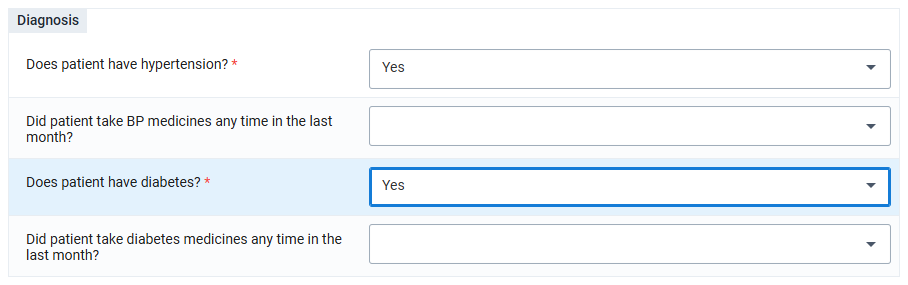 | 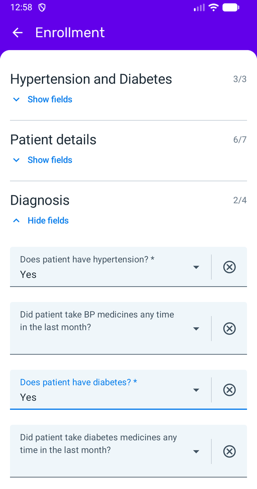 |

In the visit, the blood sugar fields follow the measure and unit. With FBS in mg/dL, only the FBS mg/dL reading is shown:

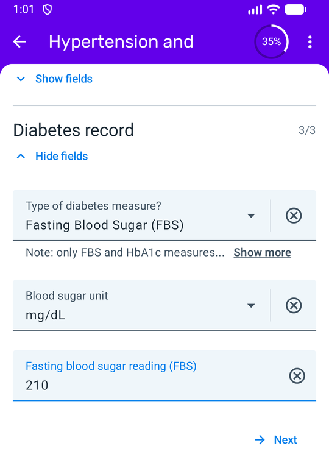{ .center width=40% }

For a patient with both conditions, all 12 medicine fields are shown:

| Capture (web) | Android |
|---|---|
| 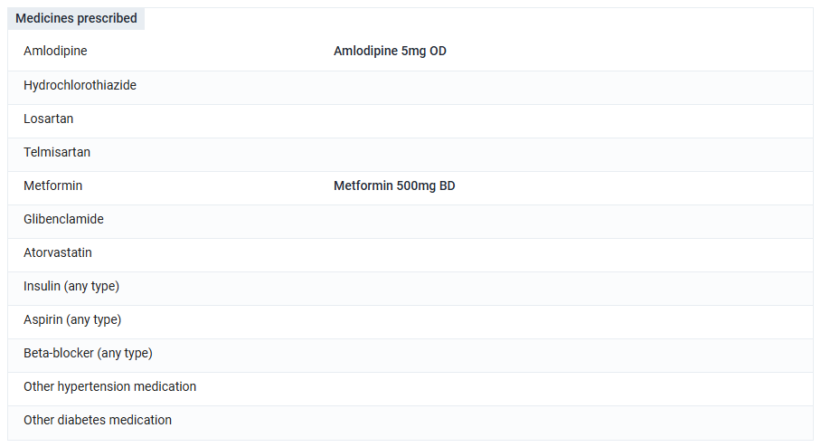 | 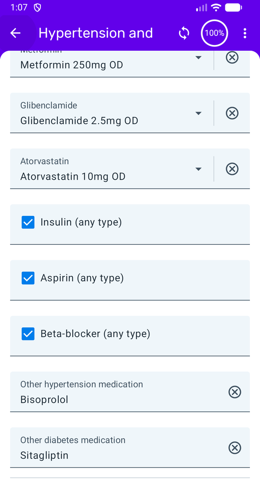 |

The feedback texts (patient status, latest BP reading) and the program indicators shown in the form (age, days since last visit, patient header) are in the *Feedback* and *Indicators* widgets on the web patient dashboard, and in the *Analytics* tab on Android:

| Capture (web) | Android |
|---|---|
| 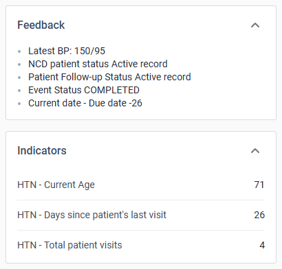 | 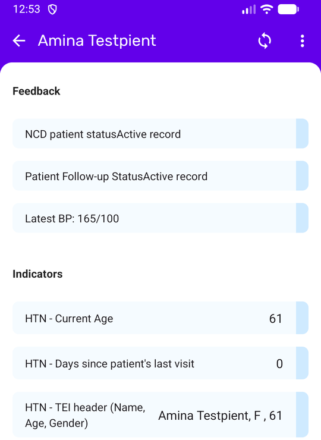 |

The calling report stage is hidden entirely for a patient who is not currently flagged overdue, and shows the patient's phone number only when relevant to the call outcome being recorded.

#### Recall of overdue patients { #ncd-hdm-design-recall }

A patient is overdue when a scheduled Hypertension & Diabetes visit is past its due date and no visit has been recorded. Recall covers patients with hypertension, diabetes or both. It uses the patient follow-up status attribute (`HTN - Patient follow-up status`, with the values Upcoming visit, Overdue pending call and Called), the Calling report stage, and overdue working lists in Capture that filter on the status.

The package includes three working lists on the visit stage: *Due today*, *High-Risk DM* and *High-Risk HTN*. They show in Capture and in the Android app:

| Capture (web) | Android |
|---|---|
| 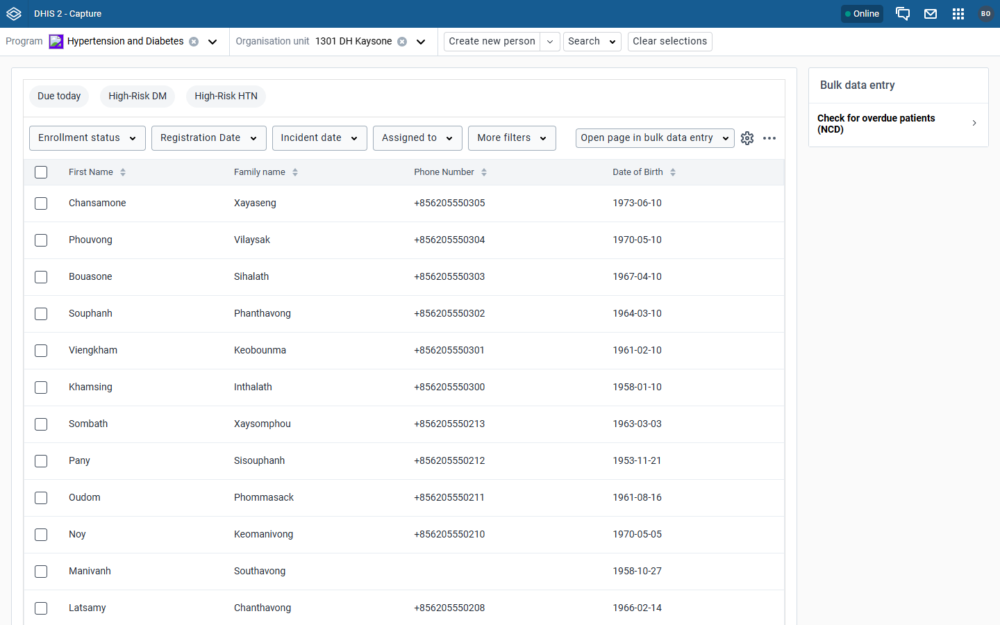 | 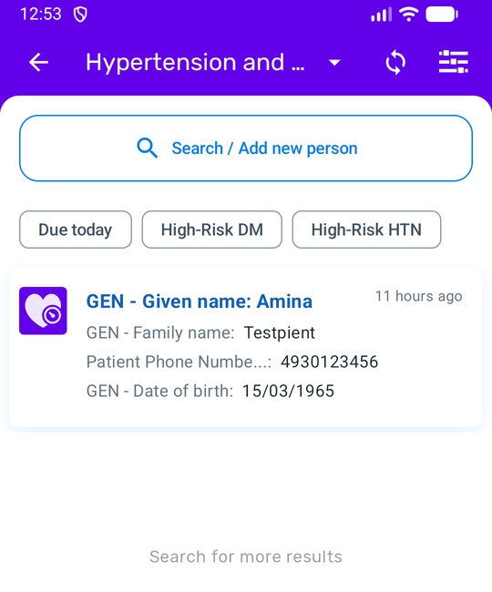 |

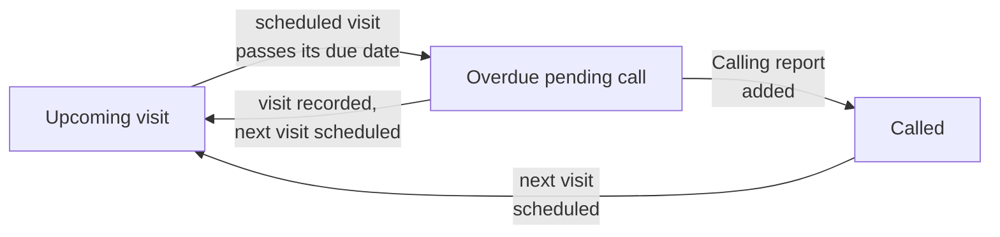

> **Important**
>
> DHIS2 does not set the follow-up status by itself. Program rules run only while a user has the patient open, and nothing runs when a due date passes. Without extra setup the status never becomes "Overdue pending call". The overdue working lists then stay empty, the Calling report stage is never shown, and the contactable overdue patients indicator is always 0.

We recommend installing the database triggers and nightly SQL function from the RTSL package ([simpledotorg/dhis2-hypertension-package, scripts folder](https://github.com/simpledotorg/dhis2-hypertension-package/tree/main/scripts)). They use the same program, stage and attribute IDs as this toolkit, and they use the `event` table introduced in DHIS2 2.41. Two scripts are needed:

- [`update-tracked-entity-attribute-values-trigger.sql`](https://github.com/simpledotorg/dhis2-hypertension-package/blob/main/scripts/update-tracked-entity-attribute-values-trigger.sql) creates three triggers and one function. The triggers set the status to Upcoming visit when a visit is scheduled, to Overdue pending call when the Android app marks a scheduled visit overdue, and to Called when a Calling report is added. The function `update_overdue_pending_call_trigger_function` sets Overdue pending call for every active enrollment whose scheduled visit is past due. Run it every night with a cron job.
- [`update-tracked-entity-attribute-values-in-legacy-data.sql`](https://github.com/simpledotorg/dhis2-hypertension-package/blob/main/scripts/update-tracked-entity-attribute-values-in-legacy-data.sql) is run once at installation, to set the status for patients who are already overdue.

The setup steps and the cron entry are in the RTSL installation guide, section [Triggers for Tracked Entity Attribute Updates](https://github.com/simpledotorg/dhis2-hypertension-package/blob/main/doc/installation_guide.md#triggers-for-tracked-entity-attribute-updates). The scripts need direct access to the DHIS2 database, so a hosted instance without database access cannot use them.

> **Caution**
>
> The scripts write to DHIS2 tables directly. Test them again after each DHIS2 upgrade.

The RTSL package has two more scripts that this toolkit does not need. `update-htn-and-diabetes-visits-trigger.sql` copies Calling report data into the visit event, because the RTSL program indicators could not read two stages; the NCD_HDM enrollment program indicators read both stages directly. `sql_agg_calculate_and_store` computes the overdue figures in SQL; here, program indicators calculate them and the aggregate data exchange stores them in the recall dataset.

Where there is no database access, for example on a hosted instance, the [Patient recall plugin](https://github.com/iambodo/patient-recall-plugin) does the same job from Capture. It is a Bulk Data Entry plugin. A user selects the program and an organisation unit, and clicks **Check for overdue patients** in the sidebar. The plugin flags overdue patients and clears those who are no longer overdue. It then lists the patients who have not been called yet, with their phone number and scheduled date. The user records the result of each call in the list, and **Save all** creates the Calling report events and sets the status to Called. The status only changes when someone runs the check, so the plugin suits a facility that calls patients on set days. It works in Capture on the web only; Android users see the new status after their next sync. The plugin is a prototype. The [installation guide](#ncd-hdm-recall-plugin) has the setup steps.

> **Warning**
>
> Use either the plugin or the database scripts, not both. They write the same attribute.

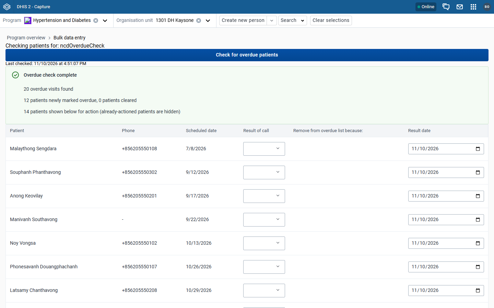

#### Data validations for patient data (program rules) { #ncd-hdm-design-program-rule-validations }

Alongside the skip logic above, program rules enforce data quality at entry: hard rejection or soft warning on implausible values for each blood sugar measurement type and unit (mg/dL and mmol/L variants of RBS, FBS, PPBS, and HbA1c), a hard error when systolic or diastolic blood pressure is missing or out of a valid range, and a date-of-birth validity check. These follow the approach in the source Hypertension Registry design, where out-of-range BP and BMI values are rejected or flagged at the point of entry rather than caught later in analysis.

Two warning-on-complete rules flag visits that the monthly indicators will not count. For a hypertensive patient, the warning shows when systolic or diastolic blood pressure is empty. For a diabetic patient, it shows when the visit has no HbA1c reading and no FBS reading in the selected unit. RBS and PPBS readings are kept for clinical use but do not count toward blood sugar control. The user can still complete the visit.

The three valid-reading fields used by the program indicators (see [Valid reading dates](#ncd-hdm-design-valid-reading-dates)) sit in a section named "Valid readings (auto-calculated, admin only)". A hide-section rule with the condition `!d2:inUserGroup('<HTN Admin group ID>')` hides it from users outside the HTN Admin user group. The fields are still filled while the section is hidden, because an assign rule takes precedence over hiding.

> **Note**
>
> `d2:inUserGroup` needs DHIS2 2.41.9, 2.42.5, 2.43 or later. On earlier versions it returns false, so the section is hidden from every user, admins included, while the fields are still filled.

Some Tracker sections and the entire calling report stage are optional and apply only where a country has deployed Tracker at all — a country in the aggregate-support scenario does not configure this program and reports through the monthly datasets directly.

#### Comparison with the RTSL and WHO tracker programs { #ncd-hdm-design-tracker-comparison }

The NCD_HDM tracker program is built on the Resolve to Save Lives (RTSL) "Hypertension & Diabetes" DHIS2 package from Simple ([simpledotorg/dhis2-hypertension-package](https://github.com/simpledotorg/dhis2-hypertension-package), `NCD_HTN_TRK_metadata-en.json`), and keeps its program, stage and attribute IDs. The RTSL column below is taken from that metadata file. The WHO NCD DHIS2 package ([WorldHealthOrganization/NCD-DHIS2](https://github.com/WorldHealthOrganization/NCD-DHIS2)) is a separate design with a wider scope.

| | NCD_HDM | RTSL Hypertension & Diabetes | WHO NCD patient monitoring form |
|---|---|---|---|
| Conditions | Hypertension and diabetes | Hypertension and diabetes | Hypertension, diabetes, asthma, COPD, and cervical, breast, childhood and other cancer screening or early diagnosis. Separate event programs for CVD risk assessment and hypertension screening. |
| Program stages | One repeatable "Hypertension & Diabetes visit" stage for both conditions, plus a "Calling report" stage | Same | 17 stages: separate initial and follow-up visit stages for each condition |
| Blood pressure | Systolic and diastolic | Same | Systolic and diastolic, with CVD diagnosis, high CVD risk and CKD recorded at the visit |
| Blood sugar | Test type (RBS, FBS, PPBS, HbA1c), unit, and a reading field per test and unit (mg/dL and mmol/L) | Same fields | HbA1c with its unit (% or mmol/mol) |
| Complications | Complications assessment multiselect: CKD assessment, retinopathy, visual acuity, foot assessment | Not included | CKD and diabetic foot assessments, and referral for retinopathy screening, in the diabetes stages; no visual acuity |
| Medicines | The RTSL list plus insulin, aspirin, beta blocker and "other diabetes medication" | Amlodipine, hydrochlorothiazide, losartan, telmisartan, metformin, glibenclamide, atorvastatin, "other hypertension medication" | Recorded by drug class (ACE inhibitor, ARB, thiazide, calcium channel blocker), plus statins and hypoglycaemic agents |
| Calculated fields | High-risk flags (uncontrolled BP or blood sugar in patients with a history of heart attack, stroke or kidney disease) and the three valid-reading fields | None on the visit; a nightly SQL job pre-computes some overdue and under-care figures | None |
| Recall | Calling report stage, patient follow-up status attribute, overdue working lists | Same, with database triggers and a nightly job that set the follow-up status | No recall workflow |
| Program rules | 51: the 23 RTSL rules (one condition changed) plus 28 added: blood sugar range checks for each test and unit (hard limits and soft warnings), high-risk flags, valid-reading fields, warnings on completion, complications display | 23: BP and date-of-birth validation, systolic/diastolic pairing, blood sugar skip logic, patient status, calling-report display | 351 across all conditions |

Three practical differences follow from this:

- **Visits.** NCD_HDM and RTSL record each visit in one event that covers both conditions. Because the WHO form separates initial and follow-up stages, its indicators read the follow-up stage for the latest values.
- **Medicines.** WHO counts treatment by drug class, so NCD_HDM medicines would need mapping to classes to report WHO's prescription indicators.
- **Additions.** A country starting from the RTSL package does not have these NCD_HDM additions:
    - the complications assessment;
    - the high-risk flags and the valid-reading fields;
    - the blood sugar range checks;
    - the four added medicines;
    - a National ID attribute and an "Administrative area of residence" field on the visit;
    - program indicators for complications, medicines and the calling report. RTSL calculates the calling-report figures with a nightly SQL job instead.

### Analytics { #ncd-hdm-design-analytics }

#### Program indicators { #ncd-hdm-design-program-indicators }

Program indicators calculate patient-level counts from Tracker enrollment and event data, feeding both the Tracker program indicator widget (shown live to the clinician) and the aggregate analytics tables (shown on dashboards). All of the current HTN/DM program indicators are enrollment-type, counting unique tracked entities (`V{tei_count}`) rather than events, which is required for any count that must not double-count a patient across repeat visits.

The core filter pattern excludes deceased patients (`!= 'DIED'`) and requires the relevant diagnosis attribute (`== 'YES'`). Analytics period boundaries on the event date set the time window, and the filter then tests the readings and visit dates inside that window. The blood-sugar control indicators nest an `if()` expression on the measurement type and unit recorded at the visit, so the same program indicator reads FBS in mg/dL, FBS in mmol/L, or HbA1c, whichever the facility used.

#### Time windows in program indicator filters { #ncd-hdm-design-time-windows }

All monthly indicators count time in calendar months. "Past 3 months" is the reporting month and the two months before it; "past 12 months" is the reporting month and the 11 before it. The windows are set by an event-date boundary "after start of reporting period" with an offset of −2 or −11 months.

Some filters also compare a visit date with the reporting period. The no-visit indicator, for example, looks back 12 months but has to exclude patients seen in the last 3. The filters do not use `d2:monthsBetween(PS_EVENTDATE:..., V{analytics_period_end})` for this, because it counts whole elapsed months, the way an age is counted. A visit on 31 August is only 2 elapsed months before 30 November, but the boundary places it outside a September–November window, so the patient would fall out of every group in that month's report. This happens in February, April, June, September and November reports.

Instead, the filters count months from a fixed first day of a month, which gives a month number, and subtract the two month numbers:

```
(d2:monthsBetween('2000-01-01', V{analytics_period_end})
 - d2:monthsBetween('2000-01-01', PS_EVENTDATE:anb2cjLx3WM))
```

The result is the number of calendar months between the visit and the reporting month, where 0 is the same month. `< 3` then selects the same visits as a −2 month boundary, and `< 1` means "during the reporting month", as used by the calling-report indicators.

#### Valid reading dates { #ncd-hdm-design-valid-reading-dates }

The patient tree follows the HEARTS360 definitions, which count a visit only when it has a valid reading. A program indicator cannot see when a value was recorded, so three hidden data elements on the visit stage store it:

- **NCD - Valid BP reading date**: the visit date, when systolic and diastolic BP are both recorded.
- **NCD - Valid blood sugar reading date**: the visit date, when an HbA1c, or an FBS in the field matching the selected unit, is recorded.
- **NCD - Valid blood sugar test**: which test it was (`HBA1C`, `FBS_MG` or `FBS_MMOL`).

Program rules fill these fields each time a visit is saved and clear them when the reading is removed. The indicators then use a 12-month event window. Within that window, `#{stage.dataElement}` returns the value from the latest visit that has one, so the date field gives the date of the patient's latest valid reading. After the diagnosis and not-dead checks, the filters are:

| Indicator | Filter |
|---|---|
| Patients under care | a valid reading date exists |
| No visit in past 12 months | no valid reading date exists |
| Controlled / uncontrolled | the latest valid reading is less than 3 calendar months old, and its values are below / at or above the threshold |
| No visit in past 3 months | under care, and not (a valid reading less than 3 calendar months old) |

"No visit in past 3 months" is written as the remainder of the other two groups. Controlled + uncontrolled + no visit therefore equals patients under care registered before the past 3 months, and under care + no visit in 12 months equals cumulative registrations. Both validation rules are equalities. For diabetes, the stored test type tells the indicator which value to compare, so an RBS recorded after an FBS does not hide the FBS. On a test instance with 10,000 synthetic patients, every month from February to November 2026 added up exactly, and an independent recalculation of the HEARTS360 definitions from the raw data gave the same counts.

Reading the stored dates across a 12-month window costs a little more than the old visit-date test. On the same test instance (10,000 patients, 74,000 visits), the full set of HTN/DM tree indicators took about 16% longer to query. Individual indicators ranged from about five times faster to about twice as slow. The calendar-month comparison itself had no measurable cost.

#### Quarterly cohort vs. monthly calculations { #ncd-hdm-design-quarterly-vs-monthly }

The monthly and quarterly indicators answer a similar question (is this patient's condition controlled?) with different reporting windows and different analytics period boundaries, and the two should not be treated as interchangeable or cross-validated against each other.

The monthly indicators (for example, "DM - Patients under care with controlled Blood Sugar at latest visit in past 3 months and registered before the past 3 months") use a **rolling** window: the boundary is fixed at "before end of reporting period" for the event date, with no cohort restriction on when the patient was registered beyond the 3-months-prior offset. Every monthly report re-evaluates every eligible patient against the latest 3 months of visits, so a patient can move between controlled, uncontrolled, and no-visit from one month to the next.

The quarterly cohort indicators (for example, "DM - Patients with controlled Blood Sugar at latest visit in this quarter") instead fix an **enrollment cohort**: the analytics period boundaries anchor both the enrollment date and the event date to the *same* quarter using `AFTER_START_OF_REPORTING_PERIOD` / `BEFORE_END_OF_REPORTING_PERIOD` with a one-period offset, so the cohort is patients registered in the *previous* quarter, evaluated on their status *this* quarter. This produces a genuine cohort trend — the same group of patients followed forward one quarter — rather than the monthly indicator's continuously rolling population, and the two are not expected to match numerically even in a stable-caseload facility.

> **Tip**
>
> Preserve this distinction in any local documentation or training: the monthly figures answer "how is the active caseload doing right now," and the quarterly figures answer "of patients registered N quarters ago, how many reached control N+1 quarters ago."

#### Comparison with HEARTS360, RTSL and WHO indicators { #ncd-hdm-design-indicator-comparison }

The NCD_HDM patient tree follows HEARTS360 ([simpledotorg/hearts360](https://github.com/simpledotorg/hearts360)). The original RTSL package indicators, which NCD_HDM inherited, describe the same concepts but implement some of them differently. The WHO NCD DHIS2 package measures control in a different way.

| | NCD_HDM | HEARTS360 | RTSL package (as inherited) | WHO NCD package |
|---|---|---|---|---|
| What counts as a visit | A valid reading: systolic and diastolic BP; HbA1c or FBS in the selected unit | A BP measurement | Any visit event for under care and lost to follow-up. "No visit in past 3 months" checks for a reading, but only at the latest visit. | The last clinical (follow-up) visit |
| Time windows | Calendar months: past 3 months = reporting month and the 2 before | Calendar months, measured from the end of the reference month | Elapsed months (`d2:monthsBetween` from the visit date), so some month-end visits fall out of every group | The reporting period; registration at least 3 elapsed months before its end |
| Under care | Valid reading in the past 12 months | BP measured in the past 12 months | Any visit in the past 12 months | No under-care group |
| Control denominator | Under care and registered before the past 3 months | Same | Same | Everyone registered for at least 3 months, including patients with no recent visit |
| BP control | <140/90 at the latest valid reading in the past 3 months | Same | Same | Risk-stratified: <130/90 for patients with CVD, CKD, diabetes or high CVD risk; <140/90 for others |
| Blood sugar control | HbA1c <7%, or FBS <126 mg/dL (<7 mmol/L) | HbA1c <7% or FBS <126 mg/dL | HbA1c <7%, or FBS <126 mg/dL (<7 mmol/L). An error in the filter meant FBS readings in mmol/L were never counted as controlled. | HbA1c <8% (<64 mmol/mol); FBS not used |
| Uncontrolled tiers (DM) | 7–8.9% / ≥9%; 126–199 / ≥200 mg/dL; 7–10.9 / ≥11 mmol/L | Same, mg/dL only | Same as NCD_HDM, including mmol/L | None |
| No visit in past 3 months | Under care, no valid reading in the past 3 months | Under care, no BP in the past 3 months | Latest visit 3–12 months ago with a reading, or latest visit in the past 3 months without one | No such group; these patients count as not controlled |
| Groups add up | Controlled + uncontrolled + no visit = patients under care registered before 3 months, exactly | Same (HEARTS360 data checks) | No. Patients whose latest visit 3–12 months ago had no reading fall out of all three groups, and so do patients with a month-end visit in some months. | Not applicable |
| Deaths | Excluded from every group, including monthly registrations | Excluded from all figures | Excluded, except monthly registrations | Not excluded in the control indicators |
| Returned to care after a call | Latest call in the month; return within 15 days, if it falls before the end of the month | First call in the month; return within 15 days, counted for the month of the call even if it falls in the next month | First call in the month (calculated by a nightly SQL job) | Not included |

Compared with the RTSL metadata, the NCD_HDM program changed the filters or boundaries of 19 program indicators. It added 12, for complications, medicines, the calling report and diabetes deaths, and dropped 2: an unused copy and "DM - Patients under care over 40y". The table shows two kinds of difference. The differences from HEARTS360 are mechanical. NCD_HDM reports the same groups with the same thresholds and adds mmol/L readings. The only remaining gap is the return-to-care indicator, because one program indicator cannot look at visits after the end of the reporting period. The differences from WHO are definitional.

> **Caution**
>
> NCD_HDM and WHO control rates are not comparable without recalculation. WHO's denominator includes patients who are lost to follow-up, its BP target depends on risk, and its glycaemic target is HbA1c <8% with no FBS. A country that reports to WHO can calculate the WHO figures from the same tracker data with separate program indicators. The NCD_HDM definitions should not be changed to match.

WHO also has facility-readiness indicators (functional BP device, HbA1c and glucose testing, core medicines) that have no equivalent in HEARTS360 or the RTSL package. In this toolkit they come from the Health Facility Profile and stock data (see [Cross-cutting](#ncd-hdm-design-cross-cutting)).

#### Data exchange { #ncd-hdm-design-data-exchange }

Countries in the EMR-already-collects-data scenario should treat the HTN/DM Tracker program as the source-of-truth patient register for NCD care, not as a pass-through to an aggregate feed. An EMR pushes standardized individual-level data — enrollments and visit-stage events, mapped onto this program's own attributes and data elements — into this program, so that enrollment, visit history, and patient status live in DHIS2 at the same individual level they exist in the EMR, rather than arriving pre-aggregated and losing that detail. This differs from treating DHIS2 as a receiver of someone else's already-computed indicator values: the program indicators described above still calculate from this tracker data exactly as they do for a patient entered directly into DHIS2 Capture, so an EMR-fed patient and a clinic-entered patient are indistinguishable in analytics once their data has landed.

This has two consequences for implementers. First, the EMR integration has to map its own patient and encounter model onto this program's attributes, stages, and data elements (diagnosis, visit date, blood pressure or blood sugar reading, medicines) rather than onto a smaller aggregate contract, which is more mapping work up front but keeps DHIS2 as a single queryable register of who is enrolled and what happened at their last visit — useful for the line lists and recall workflows a purely aggregate feed cannot support. Second, where a country instead pushes a second DHIS2 instance's NCD Tracker outputs into a national HMIS (rather than an EMR into this program), the aggregate indicator layer is still the right contract for that instance-to-instance hand-off, since both sides are already running the same tracker structure and only the analytics outputs need to travel.

The tracker importer runs the same assign rules as Capture, so visits pushed from an EMR get the valid-reading fields without extra mapping.


#### Indicators { #ncd-hdm-design-indicators }

Aggregate indicators wrap the underlying data elements and program indicators into the ratios and counts shown on dashboards: control rate, loss-to-follow-up rate, complication assessment coverage, medication coverage, and calling-report outcome rates. Most are expressed as both a count (`#`) and a percentage (`%`) version of the same underlying numerator/denominator, following the show-it-both-ways principle so a low denominator is visible alongside the rate.

A subset of core indicators also has a **change-from-last-month** variant (for example, "HTN - Controlled BP - Change vs last month (%)"), calculated as this month's rate minus the prior month's rate using `periodOffset(-1)` on both the numerator and denominator data elements. These feed the Policy dashboard's month-over-month view rather than the program-level dashboards.

#### Cross-cutting { #ncd-hdm-design-cross-cutting }

Two other DHIS2 packages can add facility readiness and medicine stock to the NCD dashboards: the Health Facility Profile (HFP) and the LMIS Monthly Stock Reporting (MSR) package. Neither is part of the NCD toolkit metadata. The subsections after the overview below describe example extensions built on a demo instance, to show how a country could connect them. They are not included in the package.

- **Stock (LMIS).** The instance's LMIS configuration already uses Monthly Stock Reporting (MSR), the aggregate-dataset tool from the DHIS2 Logistics toolkit's nine native tools. MSR reports stock on hand, receipts, distribution, and discards by item each month; extending it to the eight named HTN/DM medicines would let the item list used for stock reporting match the list already named in [Contextual implementation](#ncd-hdm-design-contextual-implementation), so a dashboard could show medicine stock-outs next to control rates for the same medicines a patient is actually prescribed. Where facility-level transactional capture (rather than a monthly aggregate count) is wanted, Real-Time Stock is the sibling Android Capture tool for that, at the cost of a heavier data model than MSR's dataset.
- **Health Facility Profile (HFP).** The HFP toolkit is a Tracker program (tracked entity type "Health Facility," enrolled once per facility) with three stages: a one-time enrollment stage, a repeatable "Healthcare system accessibility" stage, and a repeatable "Healthcare system preparedness" stage. The accessibility stage already separates "Availability of specific services" into named disease categories — HIV, TB, Malaria, NCDs, and COVID-19 — kept apart specifically for global reporting, which is a direct precedent for adding HTN/DM-specific service-availability items alongside the existing NCD category rather than inventing a new structure. The NCD section of the accessibility stage already asks about hypertension management and diabetes management services, and the "Medical equipment" section of the preparedness stage already asks about a functional blood pressure apparatus, plasma glucose testing and HbA1c testing. Further NCD items, such as a functional glucometer, belong in those same sections. HFP's data elements are coded against WHO's Harmonized Health Facility Assessment (HHFA), so a new NCD item should get an HHFA code where one exists.

##### Example extension: facility readiness from the Health Facility Profile { #ncd-hdm-design-example-hfp }

The WHO facility-based monitoring guidance has readiness indicators for a functional BP device, glucose and HbA1c testing, and the HTN and DM services themselves. HFP collects all of them, but its package only has a program indicator for the BP apparatus. The demo adds four program indicators in the same pattern: facilities whose latest assessment answered Yes for hypertension management services, diabetes management services, plasma glucose testing, or HbA1c testing.

HFP follows the same aggregate pattern as the HTN/DM program. Each program indicator writes, through the *HFP - Current period* and *HFP - Previous periods* aggregate data exchanges, into a data element in the *Health facility profile monthly summary* dataset. Each data element has a "% of all facilities" indicator, with the *HFP - Enrolled facilities* organisation unit group count as the denominator. The HFP indicators count assessments up to the end of the period. A facility assessed once therefore keeps the same answer every month until it is assessed again.

"% of all facilities" falls when facilities are enrolled but not yet assessed. HFP also has a "% of responding facilities" version of each indicator, which divides by the facilities assessed for that stage instead. The demo policy dashboard uses "% of all facilities", because a facility that hasn't been assessed can't be counted as ready.

##### Example extension: medicine stock from the monthly stock report { #ncd-hdm-design-example-stock }

The MSR package ships five placeholder items (A to E), each with four data elements (stock on hand, receipt, distribution and discard), and countries rename them to their own items. The demo renames item A to amlodipine 5 mg tablet and item B to insulin (soluble, 100 IU/mL, 10 mL vial). Facilities report the dataset monthly. A country can rename items C to E for other medicines from the [Contextual implementation](#ncd-hdm-design-contextual-implementation) list, or copy the item pattern to add more.

A stock-out is a facility reporting zero stock on hand at the end of the month. The MSR package's own stock-out indicators use `if(#{stock on hand}==0,1,0)`, which only works at facility level: at district level it tests the district total. The two demo indicators use `subExpression()`, which evaluates the condition for each facility and then sums:

```
numerator:   subExpression(if(#{Amlodipine stock on hand}==0,1,0))
denominator: subExpression(if(isNull(#{Amlodipine stock on hand}),0,1))
```

The result is the share of reporting facilities that ran out, at any level. Facilities that don't report the item, such as health centres that don't stock insulin, are left out of the denominator.

> **Important**
>
> The indicator only works if zero stock on hand reaches the analytics tables. Set the stock on hand data elements to "zero is significant", and turn on **Include zero data values in analytics tables** in **System Settings** > **Analytics**. With the setting off, the demo showed 0% stock-outs every month, because analytics dropped every facility that reported zero.

##### Example extension: comparing Tracker prescriptions with stock distribution { #ncd-hdm-design-example-prescriptions }

Where a facility runs Tracker and reports MSR, the two can be checked against each other. On the demo, two event program indicators count the visits in a month where a medicine was recorded: *DM - Visits with insulin prescribed* and *HTN - Visits with amlodipine prescribed*. Visits are a 28-day cycle, so one insulin visit is about one 10 mL vial, and one amlodipine visit is about 28 tablets. Distribution well above the visit count means patients receive the medicine but are not registered in Tracker. Visits above distribution point to a stock-out, or to prescriptions not dispensed at the facility. Both are worth a conversation at the facility's monthly review rather than a correction to either dataset.

### Dashboards { #ncd-hdm-design-dashboards }

Four dashboards are configured under the NCD_HDM prefix, each scoped to a different audience. The two program dashboards share a common structure of three sections — treatment outcomes, enrolment, and treatment and complications management — repeated once for each condition, so a user moving between the Hypertension and Diabetes dashboards finds the same layout with different indicators.

**NCD_HDM - Hypertension indicators** and **NCD_HDM - Diabetes indicators** open with a **treatment outcomes** section: three twelve-month line charts, one each for percent controlled, percent uncontrolled, and percent with a missed visit at the latest visit in the past three months, followed by a row of six boxes giving the same three measures as both a percentage and a count for last month alone, so a low denominator is visible next to the rate. The **enrolment** section follows, combining a line-and-bar chart of patients under care against total registrations over twelve months, a line chart of the twelve-month loss-to-follow-up rate, a quarterly bar chart of treatment coverage, and a row of snapshot boxes (patients under care, monthly registrations, loss to follow-up, both as count and percentage) alongside the estimated adult population with the condition. Below that, the quarterly cohort report appears as a stacked bar chart showing the same four-way split used in the cohort indicators — controlled, uncontrolled, no BP/blood-sugar measurement, lost to follow-up — trended over the past four quarters, next to a count of quarterly registrations.

The **treatment and complications management** section closes each dashboard, and is where the two conditions diverge most. The hypertension dashboard shows CKD assessment coverage and anti-hypertensive medication coverage, each as a twelve-month trend and a last-month snapshot box. The diabetes dashboard shows three complication measures instead of one — diabetic foot assessment, visual acuity assessment, and CKD assessment — plus oral and injectable medication coverage, all as matching trend-and-snapshot pairs. Each program dashboard ends with a twelve-month enrolment/treatment/outcomes table (registrations, patients under care, controlled/uncontrolled/no-measurement counts and rates, missed visits, complication assessments, and medication counts, one column per month) and a definitions panel documenting every indicator and building block used above it, so a dashboard viewer does not need this guide open to read the numbers correctly.

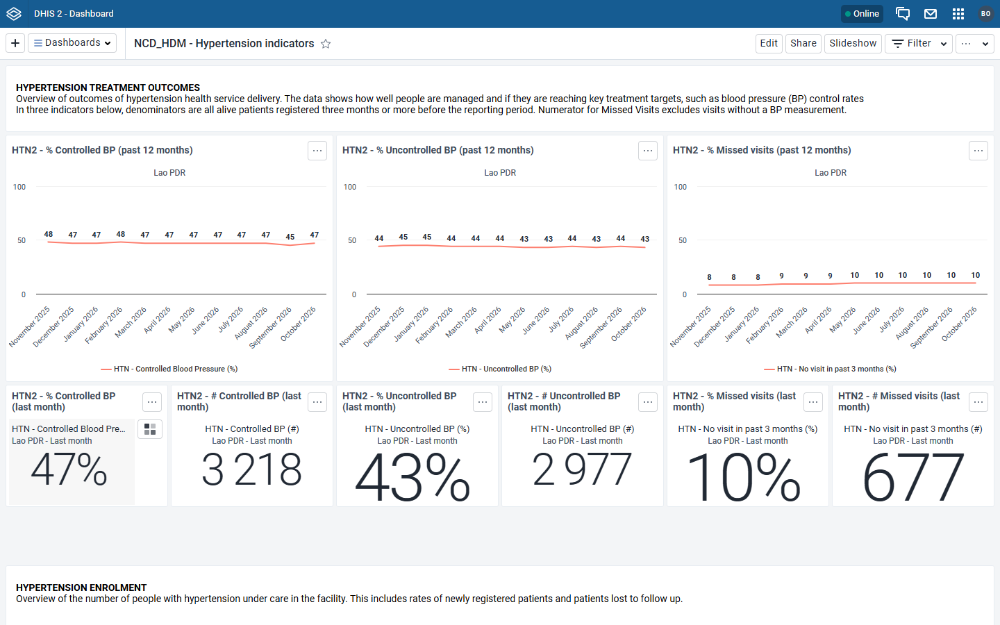

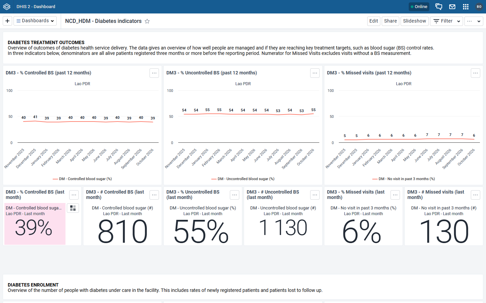

On the demo instance, a chart added below the medication charts compares insulin visits recorded in Tracker with insulin vials distributed in the monthly stock report, month by month for the last twelve months. The chart is limited to the organisation unit group *HDM - Hypertension and diabetes tracker facilities*, since only those facilities have both sources. It is meant for a facility or district user; how to read the gap between the two series is described under [Example extension: comparing Tracker prescriptions with stock distribution](#ncd-hdm-design-example-prescriptions). The chart is not part of the package dashboard.

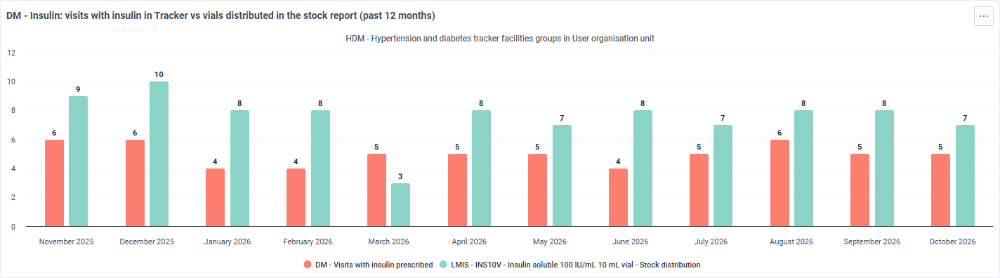

**HTN/DM Policy** (`NCD_HDM - NCD control overview`) is the high-level view, combining both conditions for a district, regional, or national user who does not need the full program-dashboard detail. It presents the core control and loss-to-follow-up rates for HTN and DM side by side, each with its change-from-last-month variant (see [Indicators](#ncd-hdm-design-indicators)) so the trend is visible without opening the underlying program dashboard. Estimated population prevalence and screening coverage, sourced from the HTN/DM screening dataset rather than the treatment programs, sit alongside the treatment figures, making this the one dashboard that shows program performance next to population-level context.

The package leaves a placeholder on the overview for Health Facility Profile charts. On the demo instance, two example charts from the cross-cutting packages were added; they are not part of the package. Next to the treatment cascades, a bar chart shows facility readiness from the Health Facility Profile for last month: the share of all HFP-enrolled facilities with a functional BP apparatus, plasma glucose testing, HbA1c testing, hypertension management services and diabetes management services. Below the cascades, a line chart shows the share of reporting facilities with a stock-out of amlodipine and of insulin over the past twelve months. A low control rate in a district can then be read against whether its facilities could test blood sugar or had the medicines in stock.

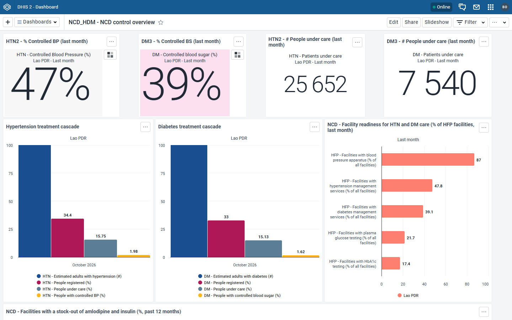

| Facility readiness (Health Facility Profile) | Stock-outs (monthly stock report) |
|---|---|
| 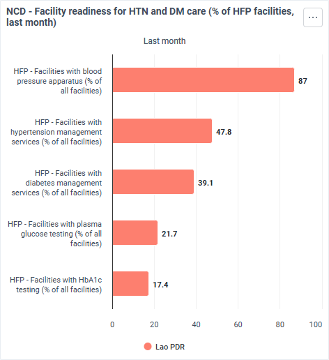 | 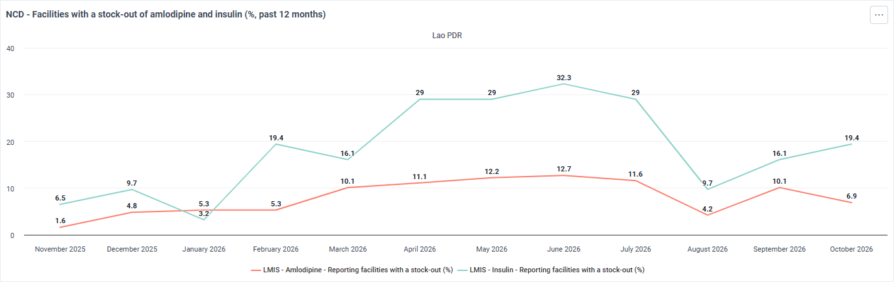 |

**NCD_HDM - Hypertension and diabetes recall** follows overdue patients with either condition through the calling workflow. The top row shows the share and number of contactable patients overdue at the start of the month, the share of them called during the month, and the share of called patients who returned to care within 15 days. Below are twelve-month trends of the same measures, the results of calls, return to care by call result, a sub-region table and a line list of overdue patients.

> **Note**
>
> The recall dashboard depends on the recall scripts or the plugin described under [Recall of overdue patients](#ncd-hdm-design-recall). Without one of them the overdue figures are 0.

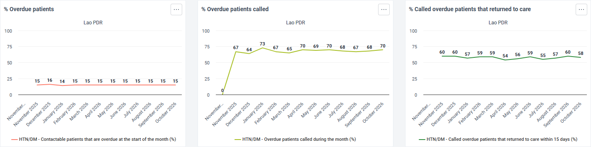


### User groups { #ncd-hdm-design-user-groups }

Facility users should have Data Capture group. Higher levels only need data access to view dashboards. Some sections are hidden during Capture data entry for everyone that does not have an Admin user group.

| User group | Metadata | Data |
|---|---|---|
| HDM - Access | view | view |
| HDM - Admin | view and edit | none, except the data exchanges and the recall dataset (see below) |
| HDM - Data Capture | view | capture and view (program, stages, tracked entity type, datasets) |

